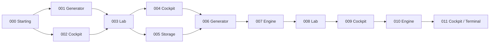

# Development Roadmap

Status: Phase 5 is approved. Phase 5A's six technical proofs passed in two actual WindowsDevelopment Mono processes over localhost, with separate Knife and Blaster runs, shared split/rejoin traversal through Terminal, and normal exits. Phase 5A is complete for owner review; this is not production networking certification. The live registry/dependency gate, implementation, automated tests, standalone evidence, and manual-input limitations are recorded below. Solo play, original Core rules, the frozen v1 generator/PRNG, and all 110 original Edit Mode and 18 original Play Mode test cases are preserved. Work stops here; Phase 6 is not authorized.

Intake date: 2026-08-30.

## Project goal and scope

Build a small, production-quality space-themed top-down dungeon crawler with deterministic procedural rooms, melee and ranged weapons, and exactly one attack command determined by the equipped weapon.

Approved design vocabulary:

- Melee weapons: Knife and Tree. Tree is intentional and must retain its name.
- Ranged weapons: Blaster, Long Blaster, and Shotgun Blaster.
- Room categories: Starting, Engine, Cockpit, Storage, Generator, and Lab.
- Flow: Main Menu -> New Game -> Starting room -> room exits and subsequent rooms. Continue restores the saved run and room. Death opens a death screen whose actions still need definition.
- Main menu: Continue only for a valid save, New Game, Load Game, Options, Exit.
- Pause menu: Resume, Options, Exit to Main Menu.
- Options: volume, resolution, Fullscreen, Borderless, Windowed; preferences stored separately from run saves.

Do not add progression, loot, currencies, classes, crafting, enemy types, death penalties, or room-specific effects without a design decision. Validate multiplayer architecture in a limited two-player technical spike after deterministic generation and basic room transitions, before larger save/content systems. Production multiplayer and Steam remain deferred. Do not install multiplayer/networking packages during the initial foundation phases.

The final direction is fixed top-down 2D using the existing URP 2D setup. NSEW describes that fixed world view; it does not mean rotating the camera between cardinal viewpoints or coupling movement to aiming. The camera follows/centers on the controlled player while maintaining a fixed orientation, independent of movement, facing, or aiming. Keyboard/mouse aiming uses the cursor's world-space position relative to the player for continuous 360-degree aim, not pointer delta. Gamepad right-stick aim uses the same aim-intention boundary. These ambiguities are resolved and their Phase 2 implementation is complete.

## Intake evidence and Phase 0 validation

The initial intake inspected project files, resolved package metadata in Library/PackageCache, saved scenes, editor session metadata, the running Unity executable, and the editor log. At that point no callable Unity Editor integration was available, so the first report could not verify live hierarchy, Console counts, or the active Build Profile. The subsequent live validation below resolves those baseline gaps without adding Editor scripts or packages.

Library/EditorInstance.json identifies the project's running editor as Unity 6000.3.21f1. Library/LastSceneManagerSetup.txt and the editor log identify SampleScene as the last recorded active scene. The live window inspection independently confirmed that project, editor version, and scene.

### Live Editor baseline validated on 2026-08-30

Validation used read-only inspection of the actual Unity windows through Windows native menus/window capture, corroborated by project files and logs. The sandbox could not see the Editor window; the permitted host-side inspection could. This establishes the visible live baseline, not a callable Unity API integration or a Play Mode/build test.

| Check | Confirmed live state |
| --- | --- |
| Editor / project | Responsive Dungeon-Crawler Editor, Unity 6.3 LTS 6000.3.21f1, DX12. ProjectVersion.txt records revision c02631ffc030. |
| Scene / hierarchy | SampleScene open, with Main Camera and Global Light 2D only. No unsaved-change marker visible on the scene/title. |
| Editor mode | Play Mode inactive. No Play Mode session or forced compilation was initiated during validation. |
| Console | At 02:57, 03:00, and the 03:06 clarification recheck (America/New_York): 0 errors, 0 warnings, 0 messages; search field empty. The Console was not cleared or its filters changed by this validation. |
| Active build target | Windows platform, Intel 64-bit, Build and Run on Local Machine. Windows Server is not the active platform. |
| Active profile | Built-in Windows platform configuration using the shared scene list; no custom Build Profile assets or Development/Release profile pair. Development Build is unchecked. This is not an authored Release profile. |
| Build scene list | Scenes/SampleScene enabled at index 0, corresponding to Assets/Scenes/SampleScene.unity. |
| Project state | Template assets plus the roadmap and Unity-generated metadata; no gameplay scripts, prefabs, menus, generation, saves, project tests, or project assemblies added. Existing uncommitted settings changes preserved. |

File checks reconfirmed URP 17.3.0 with Renderer2D, Input System 1.20.0 as the sole input backend, Force Text serialization, Visible Meta Files, and matching cached/locked package versions. No multiplayer packages were installed. Historical startup diagnostics remain in Editor.log; they are not current Console entries. No tests, builds, settings changes, scene edits, or Phase 1 implementation were performed.

After the owner's fixed top-down 2D/NSEW clarification, live window inspection at 03:06-03:07 America/New_York reconfirmed the same Editor/scene/Console baseline and Windows Intel 64-bit platform configuration, shared SampleScene list, no custom profiles, and Development Build off. The design clarification changes documented requirements only; it does not change the current scene, input asset, or camera behavior.

### Intake findings (historical Phase 0 baseline)

| Area | Observed state |
| --- | --- |
| Unity | 6000.3.21f1, revision c02631ffc030; Unity 6.3 LTS. ProjectVersion.txt, editor metadata, and executable path agree. |
| Project maturity | Essentially a fresh Universal 2D template, with eight non-meta content files before this document. No game implementation found. |
| Rendering | URP 17.3.0, using Assets/Settings/UniversalRP.asset and Renderer2D.asset. All six quality levels reference that pipeline asset. GraphicsSettings has no default pipeline assigned, so the quality overrides are important. Linear color space; editor default behavior is 2D. |
| Input | Input System 1.20.0 only (activeInputHandler = 1). The template InputSystem_Actions asset is assigned as project-wide actions. Legacy InputManager.asset exists but is not the selected backend. |
| Scenes | Assets/Scenes/SampleScene.unity and Assets/Settings/Scenes/URP2DSceneTemplate.unity. Only SampleScene is enabled in the shared build scene list. The latter scene is a template dependency. |
| Hierarchy | Live SampleScene confirms Main Camera and Global Light 2D only; both saved scenes contain these two roots. The saved camera is orthographic, size 5, at (0, 0, -10), with AudioListener and UniversalAdditionalCameraData. The light uses the package Light2D component. No player, room, UI, or gameplay objects. |
| Gameplay scripts / namespaces | No project C# scripts or managed plug-ins in Assets; no project namespaces or established gameplay architecture. Scene script GUIDs resolve to URP package components. |
| UI | uGUI 2.0.0 and built-in UI Toolkit support are available. No Canvas, UIDocument, UXML, USS, menu controllers, or project UI assets were found. Installed UI packages do not establish a chosen UI architecture. |
| Save system | None found. No save DTOs, persistence code, save selection, or Continue validation. |
| Procedural generation | None found. No generator, graph model, room definitions, or room prefabs. |
| Console / compilation evidence | Live Console: 0 errors, 0 warnings, 0 messages with an empty search field. No C# diagnostics or compilation-failure markers found in the inspected editor log. Historical URP Terrain/Lit warnings, a D3D12 info-queue diagnostic, and licensing-handshake errors followed by recovery remain in that log; their runtime impact was not tested. No forced compilation was performed. |
| Tests | Unity Test Framework 1.6.0 is installed; no project Edit Mode or Play Mode tests exist. Package tests are not project tests. |
| Assembly Definitions | No project .asmdef or .asmref files. Package assemblies exist independently. |
| Build Profiles | Live Build Profiles confirms Windows active, Intel 64-bit, using the shared scene list. Development Build is off. No custom profile assets in Assets and no Development/Release pair. This live result supersedes the initial ambiguity from cached Library profile data. |
| Design overlap | URP 2D rendering, an orthographic camera, project-wide Player/UI input actions, and testing infrastructure are present. None of the specified gameplay or menu flows are implemented. |

### Existing folder structure

Before adding this documentation, the content tree was:

```text
Assets/
    DefaultVolumeProfile.asset
    InputSystem_Actions.inputactions
    UniversalRenderPipelineGlobalSettings.asset
    Scenes/
        SampleScene.unity
    Settings/
        UniversalRP.asset
        Renderer2D.asset
        Lit2DSceneTemplate.scenetemplate
        Scenes/
            URP2DSceneTemplate.unity
```

Every existing content asset had a .meta file. This audit adds only Assets/_Project/Docs/DevelopmentRoadmap.md and its parent documentation folders; Unity must generate any new metadata. No existing content was moved or renamed.

### Relevant installed packages

Versions were checked against packages-lock.json and local package.json files; no cached-version mismatches were found.

| Package | Version | Purpose / decision |
| --- | --- | --- |
| com.unity.render-pipelines.universal | 17.3.0 | Existing render pipeline; preserve. |
| com.unity.render-pipelines.core / com.unity.shadergraph | 17.3.0 each | Existing rendering dependencies. |
| com.unity.inputsystem | 1.20.0 | Retain for gameplay and UI commands. |
| com.unity.ugui | 2.0.0 | Installed; no project UI to replace. |
| com.unity.modules.uielements | 1.0.0 | Built-in UI Toolkit module, versioned with the editor. |
| com.unity.test-framework | 1.6.0 | Use for project Edit Mode / Play Mode tests. |
| com.unity.test-framework.performance | 3.5.0 | Transitive dependency; installed, not a configured profiling suite. |
| com.unity.ext.nunit | 2.0.5 | Test dependency. |
| com.unity.2d.animation | 13.0.5 | Template package. |
| com.unity.2d.aseprite | 3.0.2 | Template package. |
| com.unity.2d.psdimporter | 12.0.2 | Template package. |
| com.unity.2d.spriteshape | 13.0.0 | Template package. |
| com.unity.2d.sprite / com.unity.2d.tilemap | 1.0.0 each | Built-in 2D tools. |
| com.unity.2d.tilemap.extras | 6.0.2 | Template package. |
| com.unity.2d.common / com.unity.2d.tooling | 12.0.3 / 1.0.3 | 2D dependencies/tooling. |
| com.unity.burst / com.unity.collections / com.unity.mathematics | 1.8.30 / 2.6.8 / 1.3.3 | Dependencies already present; no ECS architecture implied. |
| com.unity.multiplayer.center | 1.0.1 | Editor tooling, not an implemented networking stack. |
| com.unity.timeline / com.unity.visualscripting | 1.8.12 / 1.9.12 | Installed but no authored gameplay found. |
| com.unity.collab-proxy | 2.12.4 | Unity Version Control integration; repository currently uses Git. |
| com.unity.ide.rider / com.unity.ide.visualstudio | 3.0.40 / 2.0.26 | Editor integrations. |

Cinemachine, Addressables, Netcode for GameObjects, Unity Transport, the Multiplayer Services SDK, Multiplayer Play Mode, and Steam integration packages were not found in the resolved dependency list. Do not install them as part of intake. Retain existing packages until there is a reason to change them. In particular, add no multiplayer/networking packages during the initial foundation phases; defer spike-specific package selection and installation until Phase 5A and its scope/stack approval gate. The already installed Multiplayer Center does not constitute a runtime networking implementation.

### Input details

- Player actions: Move, Look, Attack, Interact, Crouch, Jump, Previous, Next, Sprint.
- Move includes WASD/arrows and gamepad left stick. Attack includes mouse left button, Enter, and gamepad west button. There is already one Attack action.
- The existing template Look action uses pointer delta and gamepad right stick. Mouse aim semantics are now resolved: absolute mouse position determines a 360-degree world-space direction on the 2D gameplay plane, independently of movement. Adapt the actions in Phase 2; do not use mouse delta as the primary aiming model. The input asset is unchanged during Phase 0.
- Interact uses a Hold interaction. Confirm whether room interaction should require a hold.
- There is no Player/Pause or Player/Aim action.
- UI already has Navigate, Submit, Cancel, Point, and Click, plus template extras.
- Control schemes: Keyboard&Mouse, Gamepad, Touch, Joystick, XR. Their presence is not a commitment to ship on all of those devices.
- Wrapper-code generation is disabled and there is no gameplay consumer. Do not implement jump, sprint, crouch, or weapon switching merely because template bindings exist.

### Team configuration and existing work

- Asset Serialization is Force Text; Version Control Mode is Visible Meta Files. Preserve both.
- Git ignores Library, Temp, Logs, and UserSettings. The attributes file assigns Unity YAML merging and LFS rules for media.
- The local unityyamlmerge merge driver was not configured in the inspected Git configuration. LFS filter-process is configured. Team setup should verify Smart Merge and LFS availability on each workstation; neither was changed during intake.
- Existing uncommitted changes were present in UniversalRP.asset, ProjectSettings.asset, and URPProjectSettings.asset, with PackageManagerSettings.asset untracked. They were left intact. Their contents include URP serialization-version changes and project/cloud identity settings; authorship was not assumed.
- Player settings retain template identity values, including DefaultCompany. Release identity, desktop scripting backend, display behavior, and supported platforms require deliberate profile configuration later.

## Current architecture and implemented systems

Phases 1–5 implement application flow, local player/input/camera, Knife/Blaster combat, deterministic abstract generation and authored-room traversal in two runtime assemblies. Core owns the plain-C# rules, immutable graphs and progression and has no Unity/NGO references. Gameplay supplies explicit Unity composition, physics/world adapters and presentation. Phase 5A adds a limited host-authoritative network adapter around those same rules, plus graph agreement and shared exit readiness. Solo New Game still generates one graph and loads the Starting prefab. URP 2D, fixed camera orientation, absolute-pointer aiming and the input asset GUID remain. Saves, production equipment, enemies and production networking remain unimplemented. See the phase reports for regression, standalone and manual-input evidence and limits.

## Architecture direction (approved; implemented through Phase 5A host-authoritative spike)

1. Use Assets/_Project for new project-owned content, following the requested Art, Audio, Data, Materials, Prefabs, Scenes, Scripts, Settings, Tests, and Docs grouping as each area becomes necessary. Leave existing template assets in place unless an approved change requires otherwise.
2. Start with two runtime assemblies: SpaceCrawler.Core for plain C# state, deterministic generation, and save models; SpaceCrawler.Gameplay for Unity-facing adapters and composition. Keep UI, Audio, Save, Platform, Player, Combat, and Rooms in focused folders/namespaces. Use separate Edit Mode and Play Mode test assemblies. Split UI into an assembly only when it improves a real dependency boundary. Gameplay depends on Core; Core must not depend on Unity presentation.
3. One explicit composition root constructs run services and supplies serialized/constructor dependencies. Use explicit application states (Boot, MainMenu, Loading, Gameplay) and gameplay states (EnteringRoom, Playing, LeavingRoom, Paused, PlayerDead). Avoid mutable global state and scene searches.
4. Keep boot/menu concerns separate from a persistent gameplay scene. The gameplay scene contains player instances, local camera/presentation, and a room container; authoritative run/player state belongs to gameplay systems, not scene presentation. RoomLoader replaces reusable room prefab instances within that scene. Do not introduce a streaming system. Application/session dependencies are handed to scene adapters explicitly; avoid an implicit global "the player" dependency.
5. Separate player input, motor, health, weapons, and presentation. Use the approved fixed top-down URP 2D direction: keyboard movement is in the XY gameplay plane, independent of aiming; the camera follows the player's resulting position with a fixed orientation. Convert absolute mouse position to a point on the 2D world plane and derive the player-to-pointer aim direction over the full 360 degrees. Do not use mouse delta as the primary aim model or rotate the camera between cardinal views. Input adapters translate keyboard/mouse and gamepad input into gameplay commands/intentions, including exactly one Attack command that uses the aim direction. They request actions rather than directly changing authoritative position, health, cooldowns, equipment, or run/room state. Gameplay systems validate and apply requests; presentation consumes resulting state. [Unity's Input Actions](https://docs.unity3d.com/Packages/com.unity.inputsystem@1.20/manual/Actions.html) support the separation of intent and device bindings.
6. WeaponDefinition and RoomDefinition ScriptableObjects contain stable IDs and static configuration. Equipped-weapon state, cooldowns, health, and run progress belong to runtime objects. Use reusable melee and projectile attack behaviors, adding only configuration fields needed by the current slice. Preserve all five named weapons without inventing acquisition systems.
7. RunGenerator produces DungeonGraph / RoomInstanceData independently of GameObject creation. Specify a PRNG and stable definition ordering so generation does not depend on UnityEngine.Random global state or unordered collections. Record stable run-local room IDs. Persistence must account for generator/content changes through versioning or sufficient stored graph data; a seed alone is not a cross-version reconstruction guarantee.
8. Use a versioned save DTO and a separate storage boundary under Application.persistentDataPath. Save only implemented state. Use stable definition IDs, validate before offering Continue/Load, and write via a temporary file with safe replacement/recovery appropriate to the target platform. Treat room transitions as checkpoint boundaries, with exact checkpoint timing decided before implementation.
9. Prefer UI Toolkit for menus using UXML, USS, and presenters. Add menu focus, controller navigation, and gameplay/UI input gating early. [Built-in UI Toolkit](https://docs.unity3d.com/6000.3/Documentation/Manual/UIE-Runtime-Event-System.html) can use the active Input System backend.
10. Persist options separately from saves. Use a master AudioMixer route when adding audio and volume controls; no mixer exists yet. Keep resolution/display APIs and eventual Steam integration in platform adapters. Consider Cinemachine 3 only after the camera requirements justify it. Use Awaitable/cancellation for real loading workflows and UnityEngine.Pool only for justified repeated projectile/effect creation.

### Authority boundary from the foundation

Use this direction from the first gameplay implementation:

```text
Input
-> gameplay command/intention
-> simulation/gameplay system
-> resulting state
-> presentation
```

- Initially, requests execute against a local simulation without networking packages. Keep the request boundary explicit and small; ordinary method calls and focused command data are sufficient. Do not build a generic command bus, replay framework, or speculative networking abstraction.
- Associate gameplay requests with an explicit player identity/context. Simulation/gameplay systems own movement rules, attack validation, cooldowns, damage, and run/room transitions. Input and UI cannot bypass those systems to author authoritative state.
- Movement intention and world-space aim intention are independent. The single Attack request uses that aim direction through Input -> Command -> Simulation -> State -> Presentation. Neither pointer input nor the following camera directly resolves attacks or damage.
- Presentation observes resulting state/events and handles visuals, audio, and the local camera. Visual ownership does not confer authority over gameplay. A motor may use Unity physics as part of the simulation; it is not an input-owned transform writer.
- The later spike adds the minimum session/transport adapter needed to deliver requests to one agreed authority and distribute resulting state. Local and remote players must use the same gameplay rules, rather than separate authoritative implementations.
- One authority owns the procedural run seed, generated run information, and current room/transition state. Clients may reconstruct layout from agreed generation data but must not independently choose a competing seed or advance the run.
- Deterministic room generation does not imply deterministic physics, lockstep simulation, or a requirement to build prediction/rollback now.

## Phase 1 implementation and validation — 2026-08-30

### Implemented scope and architecture

The owner approved Phase 1 only. The resolved URP 2D, fixed-orientation camera, independent movement/aim, absolute world-space mouse aiming, and eventual directional-stick gamepad aiming requirements were recorded before implementation. None of the Phase 2 player/input/camera behavior was implemented.

The application flow is deliberately small:

```text
UI input -> ApplicationCommand -> ApplicationFlow rules -> ApplicationState -> Unity scene/UI presentation

Boot -> Loading -> MainMenu -> Loading -> Gameplay placeholder -> Loading -> MainMenu
MainMenu -> Exiting
```

- `ApplicationFlow` is plain C# with private state mutation. It accepts valid commands, rejects out-of-context/repeated requests while loading, validates completion destinations, and restores the source state on loading failure. `Exiting` is the only additional state beyond the four required states, to represent the approved Exit action explicitly.
- `ApplicationRoot` is the one Boot composition root. It constructs the flow, persists across scene changes, loads explicitly serialized scene paths, instantiates explicitly referenced UI prefabs, and injects the flow into each screen. Scene loading is asynchronous, and teardown cancels abandoned continuations. No runtime singleton, global mutable state, service locator, dependency framework, or scene-wide lookup is used.
- `ApplicationScreen` translates UI actions into commands and observes resulting state. It never assigns application state or performs scene loading. Loading disables further transition buttons. Scene teardown removes the screen's event subscriptions.
- UI Toolkit supplies Main Menu and the clearly labeled Gameplay placeholder. New Game, Return to Main Menu, and Exit work. Continue, Load Game, and Options are visibly disabled with explanatory labels/tooltips. There is no save-system stub pretending to load a run.
- Boot, MainMenu, and Gameplay use fixed orthographic cameras and the existing renderer. These cameras only render the foundation screens; no follow, movement, aim, or combat behavior was added. Menu/gameplay screen prefabs are instantiated by the composition root, so normal entry is through Boot.
- All scenes, prefabs, PanelSettings, and the Build Profile were authored by Unity Editor APIs. No Unity YAML was manually authored. SampleScene and all template assets were retained.

### Files and assembly boundaries

Paths below are under `Assets/_Project/`; Unity-generated `.meta` files accompany every new file/folder.

| Area | Created files/assets |
| --- | --- |
| Core | `Scripts/Core/ApplicationCommand.cs`, `ApplicationState.cs`, `ApplicationFlow.cs`, `SpaceCrawler.Core.asmdef` |
| Unity adapters/composition | `Scripts/Gameplay/ApplicationRoot.cs`, `ApplicationScreen.cs`, `SpaceCrawler.Gameplay.asmdef` |
| Scenes | `Scenes/Boot.unity`, `MainMenu.unity`, `Gameplay.unity` |
| UI prefabs | `Prefabs/UI/MainMenu.prefab`, `GameplayPlaceholder.prefab` |
| UI Toolkit | `UI/MainMenu.uxml`, `GameplayPlaceholder.uxml`, `Foundation.uss`, `FoundationTheme.tss`, `FoundationPanel.asset` |
| Build Profile | `Settings/BuildProfiles/WindowsDevelopment.asset` |
| Edit Mode tests | `Tests/EditMode/ApplicationFlowTests.cs`, `SpaceCrawler.Tests.EditMode.asmdef` |
| Play Mode tests | `Tests/PlayMode/ApplicationSceneFlowTests.cs`, `SpaceCrawler.Tests.PlayMode.asmdef` |
| Editor utilities | `Editor/FoundationAssets.cs`, `FoundationValidation.cs`, `FoundationTestRecorder.cs` |
| Documentation | Updated this roadmap; no empty future-system folders were created. |

Assembly dependency direction:

- `SpaceCrawler.Core`: plain C#, `noEngineReferences: true`; no gameplay/presentation dependency.
- `SpaceCrawler.Gameplay` -> `SpaceCrawler.Core`; Unity-facing scene/UI/composition adapters only.
- `SpaceCrawler.Tests.EditMode` -> `SpaceCrawler.Core` plus the existing test framework; Editor-only.
- `SpaceCrawler.Tests.PlayMode` -> `SpaceCrawler.Core`, `SpaceCrawler.Gameplay` plus the existing test framework. Test assemblies are excluded from the normal player build.
- Authoring/validation utilities use Unity's default `Assembly-CSharp-Editor`. No additional custom editor or future-system assembly was introduced. Their inspection-only object discovery is not used by runtime code.

### Validation results

Validation ran in the live Unity 6000.3.21f1 Editor and in the built Windows player, using native window controls/screenshots and the project Editor utilities.

| Check | Result |
| --- | --- |
| Import/compilation | Passed for Core, Gameplay, both test assemblies, UI assets, and Editor utilities. No remaining C# errors or warnings. |
| Edit Mode | **9 passed, 0 failed, 0 skipped**. Covers transition order, all four commands during loading, invalid completions, failure/retry, Exit, and unsupported/out-of-context commands. |
| Play Mode integration | **1 passed, 0 failed, 0 skipped**. Two complete round trips through actual scenes/UI events; disabled menu controls, input gating during loading, duplicate-request rejection, old-screen destruction, and exactly one persistent root/screen checked. |
| Visible Editor flow | Passed Boot -> Main Menu -> clicked New Game -> Gameplay placeholder -> clicked Return -> Main Menu. Clicking disabled Continue caused no transition. Clicking Exit stopped Play Mode and restored the saved Boot scene. |
| Profile | Active custom Windows Development profile, Windows Intel 64-bit / `StandaloneWindows64`, Local Machine, Development enabled. Its scene override contains Boot, MainMenu, Gameplay in that order. The global SampleScene list is unchanged; no Release/Steam profile exists. |
| Development build | **Succeeded, 0 errors, 0 warnings** using `BuildPipeline.BuildPlayer(BuildPlayerWithProfileOptions)` with the new profile. Initial build: 84.09 seconds, 169,025,184 bytes reported by Unity. |
| Standalone smoke test | Passed at 1280x720: Main Menu rendered; Continue stayed unavailable when clicked; New Game opened the placeholder; Return restored the menu; Exit logged `Exiting` and closed the process. No errors or warnings in the player log. The host initially launched the process hidden; showing its interactive window allowed normal scene completion. |
| Console | Final validation: **0 errors, 0 warnings**; remaining messages are development transition/build/test logs. The reporting utility does not clear the Console; Unity's existing Play/Test behavior can reset displayed entries. |
| Scope/package checks | No movement, aiming, following camera, weapons, generation, rooms, health, enemies, saves, multiplayer, Steam, or Phase 7 features added. Package manifest/lock and template input actions remain unchanged. |

Build output: `Builds/WindowsDevelopment/Dungeon-Crawler.exe` with its sibling data/runtime folders. Keep those folders together when running/copying the build. This is a Development build, not a distribution/Steam deliverable.

Local validation evidence (ignored by Git): `Logs/Phase1/EditMode.xml`, `PlayMode.xml`, their summary files, `Build.summary.txt`, `EditorContinueCheck.txt`, `EditorGameplayCheck.txt`, `EditorReturnCheck.txt`, `EditorExitCheck.txt`, `EditorState.txt`, `PlayerSmoke.log`, and `PlayerExit.json`. The process-close check succeeded; a numeric process exit code was not captured. Native captures also verify the Editor and standalone UI.

### Corrections, preservation, and limitations

- Validation corrected a stale prefab-reference issue in the first Boot authoring pass before gameplay testing. Boot now has one explicitly wired root; running the authoring command again preserves existing assets and does not duplicate it.
- The first Play Mode launch conflicted with the Boot startup-scene override. The test utility now suspends that override while tests run and restores it on completion or launch failure. Temporary test scenes were cleaned up. Incorrect test assumptions about keyboard-submit targeting and informational development logs were fixed, and the full suite was rerun successfully. These were not waived failures.
- Final evidence inspection caught an old test callback overwriting an earlier mode's report. The recorder now has its own matching ScriptableObject script asset, filters by test mode, and immediately unregisters/destroys itself at completion. Both reports were regenerated and checked together after the fix.
- The interrupted test runner temporarily changed `runInBackground`; the original value `0` was restored. The temporary Input System preloaded-asset build entry was removed by its package callback and cleanup was saved. Existing project/cloud identity edits were retained.
- Unity's unrelated services master flag changed during building; it was restored to its original `0` through the Editor serialization API. Existing cloud project identity was not unlinked or replaced. Individual Ads, Analytics, Purchasing, and Cloud Diagnostics reporting settings remain disabled. Temporary restoration/inspection commands were removed from the final utility.
- Unity serialized derived URP shader-prefilter/runtime metadata, the default volume's Bloom filter field, ShaderGraph's default override flag, Standalone batching defaults, and `ProjectSettings/SceneTemplateSettings.json` while authoring/building. These are Editor/package-generated changes, not a renderer replacement or new gameplay feature. URP 17.3.0/Renderer2D, all existing quality-tier pipeline assignments, Input System 1.20.0, Force Text, Visible Meta Files, original scene/input assets, and existing uncommitted changes were preserved.
- Build Profile creation uses one isolated, version-sensitive Editor reflection call because Unity 6000.3 exposes activation/building publicly but keeps the platform-profile factory internal. A future Editor upgrade may require updating that authoring helper or creating the profile through Build Profiles. The saved profile and build call use Unity's normal assets/API; no runtime reflection or new package is involved.
- No architectural deviation or new owner decision is required for Phase 1. The authority boundary is established for application commands only; actual gameplay commands/player identity and the multiplayer proof remain future milestones. This work does not claim network correctness.

### Repeating validation

Use `Tools > Space Crawler > Foundation > Open Boot` for the normal entry scene. `Enter Play Mode` also starts through Boot; `Exit Play Mode` is available if needed. The existing `Create Assets` command fills missing foundation assets without deleting/recreating existing scenes or prefabs.

Use `Tools > Space Crawler > Validation > Run Edit Mode Tests` / `Run Play Mode Tests` while the Editor is idle; wait for completion before starting another run. Results are written under `Logs/Phase1`. `Report State` records scene, profile, application/UI state, and Console counts. `Tools > Space Crawler > Foundation > Build Windows Development` builds the saved profile into `Builds/WindowsDevelopment`.

## Phase 2 implementation and validation — 2026-08-30

Phase 2 was marked authorized before implementation. Baseline: Unity 6000.3.21f1, saved Boot in Edit Mode, WindowsDevelopment active, and 0 Console errors/warnings. Only the approved player/input/camera slice was added.

### Architecture, physics, and presentation

```text
Keyboard/mouse or gamepad
 -> PlayerInputAdapter
 -> MoveIntent / AimIntent (explicit PlayerIdentity)
 -> PlayerSimulation (validation, active gate, speed clamp, normalized aim)
 -> PlayerMotor / Rigidbody2D (collision-resolved movement)
 -> PlayerState
 -> aim presentation and fixed-orientation camera follow
```

- Core uses ordinary C# and System.Numerics.Vector2, without Unity references. Player identity accompanies every MoveIntent/AimIntent. Simulation rejects wrong-player and non-finite requests, normalizes valid aim, and retains the last direction for near-zero aim. Input never writes authoritative position, Rigidbody, Transform, or player state.
- ApplicationRoot instantiates an explicitly referenced GameplaySession after loading Gameplay and supplies local identity 1 and ApplicationFlow. The session wires separate input, motor, camera, and presentation components. No global player, runtime scene search, generic bus, or speculative networking framework was added.
- The configurable speed defaults to 5 world units/second. Input magnitude is capped at one, retaining smaller analog values. PlayerMotor assigns permitted velocity in FixedUpdate and records physics results. Rigidbody2D is dynamic, gravity/damping 0, Z rotation frozen, continuous collision detection, and interpolation. A radius-0.35 CircleCollider2D and zero-friction/zero-bounce material collide with four static BoxCollider2D walls around a 24-by-16 primitive floor. Blocking and wall sliding are tested.
- The orthographic camera directly centers on the interpolated player Transform at Z=-10, size 5, identity rotation; no smoothing, rotation, zoom, shake, or gameplay authority. LateUpdate orders physics-state capture, camera follow, current aim sampling, and aim presentation. A primitive line/triangle consumes resulting aim and is not a weapon.

### Input curation and pause

The canonical Assets/InputSystem_Actions.inputactions retains GUID `2bcd2660ca9b64942af0de543d8d7100`, existing Move/Look/Attack action IDs, and byte-identical importer metadata. The UI map and control schemes are semantically unchanged. The adapter owns a clone of this asset's Player map, not a second input asset or wrapper.

- Move keeps WASD/arrows and gamepad left stick. Unsupported gameplay XR/joystick bindings and template Interact/Crouch/Jump/Previous/Next/Sprint actions were removed; UI navigation remains intact.
- Look was renamed Aim, using absolute Pointer.position and gamepad right stick. PassThrough Vector2 avoids magnitude arbitration between pixel coordinates and stick directions. Aim initial-state callbacks are disabled so re-enabling does not overwrite retained stick aim.
- Every LateUpdate, pointer screen position becomes a ray from the assigned gameplay camera, intersects the XY plane, and subtracts the presented player position. The resulting identified AimIntent becomes normalized world-space state. This runs after camera follow even without a pointer event; near-zero separation retains valid aim.
- Right stick uses the installed Input System's deadzone (0.125 to 0.925). Meaningful pointer/stick activity selects the source; small stick noise/zero retains the last aim. Gameplay rules are device-independent.
- Pause binds Escape and gamepad Start. Attack is reserved, disabled in the owned map, and has no handler or combat behavior.
- ApplicationFlow adds Paused and Pause/Resume without scene reload. UI Toolkit provides Resume, disabled Options, and Return to Main Menu. The existing HUD return remains available; HUD buttons are not keyboard/gamepad navigation targets.
- Pause disables move/aim, clears permitted movement, and stops the motor at the next physics step while UI stays active. Resume skips its activation frame and requires movement/stick controls to return to neutral before fresh input. Focus loss pauses; focus return requires explicit Resume. There is no global timeScale change.

### Files and assets

Paths below are relative to Assets/_Project unless stated otherwise. Unity generated new metadata and serialized assets through Editor APIs; no scene/prefab YAML was authored manually.

| Added | Purpose |
| --- | --- |
| Scripts/Core/PlayerIdentity.cs, PlayerIntents.cs, PlayerState.cs, PlayerSimulation.cs | Identified intentions, state snapshots, gameplay rules |
| Scripts/Gameplay/GameplaySession.cs, PlayerInputAdapter.cs, PlayerMotor.cs, PlayerCameraFollower.cs, PlayerPresentation.cs | Explicit composition and focused Unity adapters |
| Prefabs/Gameplay/ControlsTestArea.prefab | Primitive floor/grid/walls, player, aim marker, camera |
| Art/Materials/ControlsUnlit.mat; Settings/PlayerMovement.physicsMaterial2D | Existing URP unlit shader and frictionless collision |
| Editor/PlayerFoundationAssets.cs | Idempotent fixture creation and Boot wiring |
| Tests/EditMode/PlayerSimulationTests.cs; Tests/PlayMode/PlayerControlsTests.cs | Core and Unity integration coverage |

Changed: Core ApplicationCommand/ApplicationState/ApplicationFlow; Gameplay ApplicationRoot/ApplicationScreen and asmdef; Play Mode test asmdef; Boot and Gameplay scenes; MainMenu.uxml, GameplayPlaceholder.uxml, Foundation.uss; FoundationValidation.cs and FoundationAssets.cs; this roadmap; and the root input asset. Gameplay's placeholder camera is replaced by the session camera. Original template content, existing GUIDs, and pre-existing uncommitted changes are preserved. No packages changed.

### Validation

| Check | Result |
| --- | --- |
| Import/Console | Compiles; final saved Boot baseline has 0 errors and 0 warnings. Console was not manually cleared. |
| Edit Mode | **20 passed, 0 failed, 0 skipped**, including all 9 Phase 1 cases. Cardinal/diagonal/analog movement; independent normalized aim; identity/invalid vectors; physics result ownership; inactive gates; Pause/Resume/return. |
| Play Mode | **4 passed, 0 failed, 0 skipped**, including the unchanged Phase 1 two-round-trip regression. Rigidbody movement, boundary blocking/sliding, cardinal/diagonal/zero pointer aim, stationary pointer with moving player/camera, fixed rotation, virtual right stick/deadzone, pause/UI/focus/neutral-resume. Final suite rerun successfully. |
| Actual Editor | Native OS input verified WASD, diagonals, eight aim directions, independent move/aim, stationary-pointer aim during camera follow, Escape/button pause/Resume, and Return. A 0.4-second sample moved about 2 units cardinally or (1.414, 1.414) diagonally; rightward aim stayed (1, 0) during 2 units of upward movement. |
| Actual focus loss | Held D while minimizing Unity, released it unfocused, then restored: remained Paused with zero velocity. Resume stayed still; fresh D input moved normally. |
| Gamepad | Virtual Input System Gamepad events passed through the actual map/adapter/simulation. **No physical gamepad was connected** (zero outside tests); hardware feel/mappings and disconnect/reconnect are not certified. |
| WindowsDevelopment | Existing Windows Intel 64-bit Development profile and Boot/MainMenu/Gameplay scene list. Build succeeded, **0 errors / 0 warnings**, 169,235,608 bytes, 29.864 seconds. |
| Standalone | Normal interactive launch: New Game, diagonal movement/camera, absolute right/up aim, paused input gating, mouse Resume/HUD Pause/Return, Main Menu Exit. Exit code **0**. |
| Preservation | Input GUID/importer/UI verified; packages and project settings compared with Phase 2 baseline. Temporary preloaded-input cleanup saved; Unity's build-toggled services master flag restored to its original disabled value through Editor APIs. |

Evidence: ignored Logs/Phase2 contains test XML/summaries, EditorState.txt, Manual-*.txt, InputAssetValidation.json, Build.summary.txt, PlayerSmoke.log, PlayerExit.json, and baseline/change inventories. Phase 1 evidence remains in Logs/Phase1. Validation menu commands now write to Logs/Phase2. Actual Editor/standalone screenshots were captured.

### Fixes, limits, and owner decisions

- Fixed initial pointer callbacks replacing retained stick aim on Resume. Synthetic keyboard/mouse tests temporarily bypass Editor Game-view focus filtering and restore it afterward; real OS focus was tested separately. Physics assertions wait for accepted input and fixed steps, not an assumed number of render frames.
- A hidden-window launch/PrintWindow capture path produced native DirectX 12 presentation errors. Retesting the unchanged executable with normal interactive startup and visible-pixel capture did not reproduce them. The first diagnostic log is preserved; no renderer/API setting was changed.
- Native ComputeBuffer disposal/PlayerConnection memory diagnostics still occur at standalone shutdown and also appear in the preserved Phase 1 PlayerSmoke.log. Project code allocates no ComputeBuffers. This inherited renderer/engine shutdown debt remains for investigation; the normal smoke run has no managed exceptions or DirectX presentation errors and exits with code 0.
- No architectural deviation or Phase 2 design decision is outstanding. Direct camera centering, speed 5, neutral-before-resume, and automatic focus-loss pause are bounded implementation choices. Physical controller testing remains a disclosed hardware gap. Local gameplay ownership is validated; network authority/deterministic physics are not claimed.
- Work stops before Phase 3. No weapons, attacks/effects, health/damage, enemies, generation, production rooms, saves, inventory, networking, Steam, Cinemachine, Addressables, or DOTS/ECS were added. The Phase 5A spike still precedes substantial save/content work.

## Phase 3 implementation and validation — 2026-08-30

The owner approved Phase 2 and authorized only Knife + Blaster basic combat. Authorization was recorded here before implementation. The slice is complete; this report does not authorize Phase 4 or the other weapon behaviors.

### Weapon definitions, equipment, and authority

`WeaponDefinition` assets contain only static configuration. Each produces an immutable, Unity-free `WeaponConfiguration` snapshot when the explicitly composed gameplay session starts. The stable IDs are independent of asset and display names. Runtime equipment belongs to that session's `CombatSimulation`; the chosen snapshot is read-only and there is no inventory or runtime weapon-switching API. The fixture has one serialized starting-weapon reference. Editor-only **Use Knife Default** / **Use Blaster Default** commands change that reference in idle Edit Mode for validation. The final saved fixture and build start with Knife.

| Definition | Stable ID | Damage | Cooldown | Behavior configuration |
| --- | --- | --- | --- | --- |
| Knife | `weapon.knife` | 25 | 0.5 s | 2 world-unit range, 90-degree forward cone |
| Blaster | `weapon.blaster` | 20 | 0.3 s | 9 world units/s, 2 s lifetime; one projectile |

These values are fixture tuning, not a production balance commitment. Fields cover only the two implemented attack kinds. Assets contain no health, cooldown timers, current player/target, or mutable equipment state. Invalid configuration fails explicitly before use.

The implemented flow is:

```text
Local mouse / gamepad input
  -> one AttackIntent (PlayerIdentity + current accepted world-space AimDirection)
  -> CombatSimulation validates player, activity, equipment, cooldown, and aim
  -> immutable AttackExecution (attacker, sequence, weapon, origin, accepted direction)
  -> CombatResolver performs authoritative Physics2D queries / projectile spawning
  -> identified DamageRequest -> HealthSimulation -> DamageResult / resulting health
  -> primitive arc, projectile sprite, and target health presentation
```

`CombatSimulation` rejects inactive, wrong-player, unarmed, cooling-down, non-finite, zero, non-normalized, and stale/competing aim requests. An accepted attack captures the player's accepted position/aim and equipped definition and starts the configured cooldown. Rejected input is not buffered. Cooldown advances on gameplay fixed ticks and freezes while gameplay is inactive. Core has no device, scene, or physics dependency. Input neither queries hits nor spawns projectiles nor applies damage.

`HealthSimulation` owns positive maximum health and current health, validates the identified damage request, clamps applied damage to remaining health, and rejects invalid or post-depletion damage. Target adapters receive identified results and update presentation. The three primitive targets start at 100 health with unique run-local fixture IDs and two hit shapes each. At zero health their hit colliders are disabled and their appearance dims. They are non-blocking test targets, not enemies; no AI, rewards, player-death rules, loot, or content roster was added.

### Knife and Blaster execution

- **Knife:** an accepted execution gathers candidates with `Physics2D.OverlapCircleAll`. Pure `MeleeRules` check each target's center against the configured range and cone around the accepted aim. A per-execution target-ID set prevents double damage from multiple colliders. The owner is excluded. A short LineRenderer cone observes the accepted execution; it does not decide hits.
- **Blaster:** one accepted execution creates one small projectile retaining attacker identity, attack sequence, configuration, and direction. The resolver advances it with swept `Physics2D.CircleCastAll` queries and selects the nearest valid impact, excluding the owner's colliders and irrelevant triggers. The first living target receives one damage request. Solid boundary walls also stop shots. Impact or lifetime exhaustion unregisters and destroys the projectile; session unloading also removes it. Lifetime and travel freeze on pause. There is no piercing, homing, splash, ricochet, charge, repeat fire, or pooling.
- **Presentation:** existing primitive sprites and the Phase 2 unlit material are reused. Target bars read simulation health. Projectile position is authored by gameplay execution. No production art or animation framework was introduced.

The small swept-projectile implementation is the permitted alternative to a projectile Rigidbody2D. Melee uses target-center range/cone semantics, deliberately documented and tested. The existing two runtime assemblies and fixture prefab were extended rather than reorganized. These choices do not change the approved authority boundary. Unity physics is not claimed to be deterministic or network-authoritative yet.

### Input and application integration

The reserved Attack action retains ID `6c2ab1b8-8984-453a-af3d-a3c78ae1679a` and the input asset retains GUID `2bcd2660ca9b64942af0de543d8d7100`. Its existing `<Mouse>/leftButton` and `<Gamepad>/buttonWest` bindings are retained. The redundant gameplay `<Keyboard>/enter` Attack binding was removed so Enter remains a UI submission control; the UI map itself is byte-equivalent after JSON normalization and its bindings/IDs are unchanged. Move, Aim, Pause, other actions, and broader UI device schemes are preserved.

`PlayerInputAdapter` samples a press edge after the session has accepted its current aim. Holding either button does not repeat. Pause, focus loss, loading, and menu transitions disable gameplay attack input; activation requires release before a fresh press can attack. The explicitly injected UI gate picks interactive UI Toolkit buttons using panel coordinates, preventing a HUD mouse-down from attacking before its click changes application state. Resume and clicks held across Resume/new-session transitions do not leak attacks. Movement remains independent of accepted aim and camera orientation stays fixed. The UI displays the serialized starting weapon for this fixture, without adding player-facing equipment selection.

### Exact automated results

| Final suite / configuration | Result | Duration | Evidence under `Logs/Phase3/` |
| --- | --- | --- | --- |
| Edit Mode | **35 passed, 0 failed, 0 skipped** | 0.029 s | `EditMode.xml`, `EditMode.summary.txt` |
| Play Mode, final Knife default | **11 passed, 0 failed, 0 skipped** | 16.413 s | `PlayMode.xml`, `PlayMode.Knife.xml`, summaries |
| Play Mode, Blaster default | **11 passed, 0 failed, 0 skipped** | 15.716 s | `PlayMode.Blaster.xml`, summary |

All existing **20 Edit Mode and 4 Play Mode tests** are preserved unchanged and pass. New coverage adds **15 Edit Mode cases** and **7 Play Mode tests**:

- Core validation, accepted equipment/aim/origin, cooldown rejection/recovery/freeze, cone/range boundaries, identified health changes, invalid state rejection, and saturation at zero.
- Both actual ScriptableObject definitions remain unchanged by runtime attacks, cooldown changes, and damage; renaming a cloned asset/display name does not change its stable ID.
- Real fixture hit queries: forward/in-range hit, behind/out-of-range miss, multiple colliders damaged only once, movement/aim independence, and zero-health collider disabling.
- Swept projectile travel, attacker identity and owner exclusion, retained direction after aim changes, first-target-only damage/cleanup, solid-wall cleanup, missed-projectile lifetime expiry, and pause freezing.
- Synthetic keyboard/mouse/gamepad events through the actual Boot/application/session/input boundary: both Attack bindings, press-only behavior, cooldown rejection without queuing, simultaneous independent movement/aim/attack, real UI pointer clicks, held-input Resume/new-session gating, focus loss, and scene/projectile cleanup.

The projectile wall-impact assertion checks remaining lifetime rather than render-frame timing. Device tests temporarily select the Test Framework's appropriate Editor input routing and restore it afterward. Synthetic gamepad validation is not physical hardware certification. No physical gamepad was connected (`Gamepad.all.Count == 0`).

### Actual Editor and standalone validation

Actual Editor validation used native keyboard/mouse input against the running Unity 6000.3.21f1 session, with state inspection and window captures. It did not substitute direct simulation calls for the manual control checks.

| Check | Observed result |
| --- | --- |
| Boot -> New Game | Both serialized defaults entered the combat fixture with a fresh player, correct weapon label, and three targets at 100 health. |
| Knife direction / range / de-duplication | First east attack changed only the near east target to 75; rear and distant targets stayed 100. Holding for 1 s added only one further hit (50). Two rapid west presses accepted one attack and reduced only the west target to 75. The visible arc faced the accepted aim. |
| Blaster direction / first hit | First east shot reduced the nearest target to 80 and left the target behind it at 100. Holding for 0.8 s added only one further hit (60); two rapid west presses added only one hit (west target 80). A northbound projectile remained northbound after the pointer and aim moved east, then cleaned up. |
| Movement / camera | For each weapon, native north movement produced velocity `(0, 5)` while aim remained east and an attack was accepted. The following camera retained rotation `(0, 0, 0)`. |
| Pause / Resume | HUD clicks and game-area clicks while paused did not add attacks. Resume preserved attack counts for both weapons; paused Blaster projectiles remained suspended. |
| Native focus loss | Minimizing during input paused gameplay and zeroed movement. Restoring required Resume; idle recovery did not add attacks or movement. Fresh input worked afterward. |
| Main Menu | Returning unloaded the old session through the existing application flow. No scene-search composition or alternate bootstrap was introduced. |
| Final Editor | At 16:51 America/New_York: saved Boot scene, Edit Mode, not compiling, WindowsDevelopment active on StandaloneWindows64, Development enabled; Console **0 errors, 0 warnings, 0 logs**. |

The existing WindowsDevelopment Build Profile was used for both builds, retaining the Boot/MainMenu/Gameplay scene list and existing graphics/backend settings:

| Starting weapon | Build result | Errors / warnings | Size | Build time | Standalone result |
| --- | --- | --- | --- | --- | --- |
| Blaster | Succeeded | 0 / 0 | 169,270,932 bytes | 28.072 s | Passed; normal Exit code 0 |
| Knife, final output | Succeeded | 0 / 0 | 169,270,916 bytes | 7.324 s | Passed; normal Exit code 0 |

Each executable was launched visibly at 1280x720 using the existing DX12 configuration. Native input exercised New Game, aimed attacks and target health reduction, held-button behavior, movement/camera, pause/resume, focus-loss recovery, Return to Main Menu, and Exit. The final Knife smoke additionally exercised rapid presses and the zero-health target appearance. Both sessions closed normally; no standalone test process remains. The final artifact is `Builds/WindowsDevelopment/Dungeon-Crawler.exe`, accompanied by its build data. The Blaster run used the same profile with the serialized fixture default changed only for that validation, not a runtime switching system.

Evidence includes `Build.Knife.summary.txt`, `Build.Blaster.summary.txt`, `PlayerSmoke.Knife.log`, `PlayerSmoke.Blaster.log`, both exit JSON files, `Manual-*.txt` state snapshots, and `FinalEditorState.txt` under `Logs/Phase3/`. Native screenshots are retained in the session's Codex visualization directory. Logs and build output remain ignored rather than being added as project content.

### Console, preservation, limitations, and next decisions

The Phase 3 intake captured six pre-existing Unity cloud/service network errors (DNS/request failures), with no compiler failure. Subsequent compilation and Play Mode validation had no Phase 3 errors/warnings. No Console-clear command or filter change was used to hide diagnostics; the Editor's existing clear-on-play/recompile behavior accounts for the clean final view.

Both standalone logs contain the inherited `d3d12: failed to query info queue interface (0x80004002)` startup diagnostic, a ComputeBuffer disposal message at shutdown, and the native PlayerConnection allocation summary. These signatures also exist in the preserved Phase 1/2 smoke logs. No combat exception or new managed error was found. Their underlying native/renderer cause remains unisolated technical debt; a successful smoke test is not a claim that these inherited diagnostics are resolved.

Baseline hash checks confirm unchanged package manifest/lock, all ProjectSettings, original metadata/GUIDs, and all four pre-existing regression test source files. The complete preservation check covered 102 files with zero differences. Unity's BuildPipeline again changed the service master flag; it was restored to its recorded baseline via an Editor SerializedObject API, preserving project identity, and the one-time cleanup utility removed itself through AssetDatabase. No network, Steam, camera, content-management, or other packages were installed. Saved scenes and build profile assets were not rewritten by combat authoring.

No architecture deviation requires an owner decision for this completed slice. It remains a local, explicit-authority implementation, with no networking or production multiplayer claim. Physical controller certification, performance profiling, production weapon tuning, and inherited native diagnostics remain open. No pooling or speculative systems were added.

Before Phase 4, approve this slice and resolve the already-listed generation decisions: linear versus branching layout, backtracking, finite versus endless run/completion, and whether generation selects reusable rooms, generates interior geometry, or both. Tree, Long Blaster, and Shotgun Blaster behavior and production equipment acquisition/switching still require separate design approval. Phase 5A remains the required small multiplayer spike after deterministic generation and basic room transitions and before larger save/content systems. **Work stops here; Phase 4 has not begun.**

### Phase 3 file and asset inventory

All paths below are relative to `Assets/_Project/` unless stated otherwise. New Unity assets/scripts include Editor-generated `.meta` files; existing GUIDs were retained. New assets/prefab changes were authored with AssetDatabase, PrefabUtility, and SerializedObject inside the live Editor, not hand-edited YAML.

| Added files/assets | Purpose |
| --- | --- |
| `Scripts/Core/AttackIntent.cs` | Identified attack intention and immutable accepted execution. |
| `Scripts/Core/CombatSimulation.cs` | Runtime equipment snapshot, validation, cooldown, accepted execution state. |
| `Scripts/Core/HealthSimulation.cs` | Target identity, damage request/result, bounded runtime health. |
| `Scripts/Core/MeleeRules.cs` | Pure range/cone rules. |
| `Scripts/Core/WeaponConfiguration.cs` | Immutable validated static configuration and two attack kinds. |
| `Scripts/Gameplay/WeaponDefinition.cs` | ScriptableObject configuration boundary. |
| `Scripts/Gameplay/CombatResolver.cs` | Explicit target/owner registration, authoritative queries, damage routing, projectile ticking. |
| `Scripts/Gameplay/CombatProjectile.cs` | Swept movement, retained attack data, impact/lifetime lifecycle. |
| `Scripts/Gameplay/DamageableTarget.cs` | Minimal authoritative fixture target adapter and zero-health collider disabling. |
| `Scripts/Gameplay/CombatPresentation.cs` | Accepted-melee arc visualization. |
| `Scripts/Gameplay/TargetPresentation.cs` | Resulting health bar and depleted-target appearance. |
| `Data/Weapons/Knife.asset`, `Data/Weapons/Blaster.asset` | Stable static definitions. |
| `Prefabs/Combat/BlasterProjectile.prefab`, `Prefabs/Combat/DamageableTestTarget.prefab` | Small reusable primitive fixture assets. |
| `Editor/CombatFoundationAssets.cs` | Idempotent Editor asset authoring and serialized default-weapon validation commands. |
| `Tests/EditMode/CombatSimulationTests.cs`, `Tests/EditMode/WeaponDefinitionTests.cs` | 15 new Edit Mode cases. |
| `Tests/PlayMode/CombatWorldTests.cs`, `Tests/PlayMode/CombatInputFlowTests.cs` | 7 new Unity world/input integration tests. |

New folder metadata: `Data.meta`, `Data/Weapons.meta`, and `Prefabs/Combat.meta`.

| Changed files/assets | Purpose |
| --- | --- |
| `Assets/InputSystem_Actions.inputactions` (project-root asset) | Retain existing mouse/gamepad Attack bindings and remove only gameplay Enter Attack binding. |
| `Scripts/Gameplay/PlayerInputAdapter.cs` | Press-edge attack intention, activity/release gates, injected UI hit gate. |
| `Scripts/Gameplay/GameplaySession.cs` | Compose runtime combat from starting definition; sample attack after accepted aim. |
| `Scripts/Gameplay/ApplicationRoot.cs` | Explicitly connect the screen's UI gate and weapon label. |
| `Scripts/Gameplay/ApplicationScreen.cs` | Interactive UI picking and fixture weapon label. |
| `Prefabs/Gameplay/ControlsTestArea.prefab` | Extend the existing fixture with combat, three nested targets, and explicit references; Knife default. |
| `UI/MainMenu.uxml`, `UI/GameplayPlaceholder.uxml` | Basic-combat fixture wording and weapon label. |
| `Tests/EditMode/SpaceCrawler.Tests.EditMode.asmdef` | Allow definition-asset tests to reference Gameplay; Core runtime remains Unity-free. |
| `Editor/FoundationValidation.cs` | Phase 3 report directory and read-only combat/target state inspection. |
| `Docs/DevelopmentRoadmap.md` | Authorization, completed slice, validation, inventory, limits, and preserved next-phase gates. |

There are 20 added source/content files plus their metadata and 11 changed existing files. No original asset was deleted or renamed; no temporary cleanup script remains. To retest either weapon, use its idle-Editor default command, enter Play Mode from Boot, and select New Game. Run the existing Validation test commands and Windows Development build command; return the default to Knife after a Blaster-only check.

## Phase 4 implementation and validation — 2026-08-30

The owner approved Phase 3 and authorized only deterministic abstract run generation. This document recorded that authorization before implementation. The initial live check at 19:33 America/New_York confirmed Unity 6000.3.21f1, saved Boot in Edit Mode, WindowsDevelopment / StandaloneWindows64 / Development enabled, and Console 0 errors, 0 warnings, 0 logs. Existing uncommitted Phase 3 work was included in the preservation baseline, not treated as new Phase 4 work.

### Data and authority boundaries

`RoomDefinition` and `RunGenerationDefinition` ScriptableObjects produce validated immutable `RoomConfiguration`, `RunGenerationSettings`, and `RunGenerationConfiguration` snapshots. The snapshots and `RunGenerator -> DungeonGraph -> RoomNode / RoomConnection` are plain C# in SpaceCrawler.Core. The unchanged Core assembly definition has `noEngineReferences: true`; a passing test also inspects the actual compiled assembly references and rejects any Unity engine/editor dependency. No scene references, Unity objects, geometry, or prefab handles enter the graph.

New Game still follows the Phase 1 application-command/loading path. Its `GameplaySession.Bind` now creates the entire graph before composing the existing player, motor, camera, combat, and input adapters. The local session selects one 64-bit seed from OS entropy outside Core, or accepts an explicitly supplied seed through the optional `runSeed` argument. Core uses only that seed and the validated snapshot. Pause/resume retains the same graph; returning to the menu destroys the session, and the next New Game creates a new graph. Input never generates rooms, changes the seed, or chooses authoritative transitions. The Phase 1–3 Input -> Command -> Simulation -> State -> Presentation boundary is unchanged.

`DungeonGraph` retains its seed, generation version, complete immutable settings/definition snapshot, nodes, connections, and Start/Terminal IDs. `RunRoomId` is a non-negative integer assigned densely by generated layer and arm, rendered invariantly as `room-000`, `room-001`, etc. It is unique within its run, not globally across runs. Each node separately stores its stable authored definition ID, category, and structural terminal flag. Repeated `room.engine` definitions remain distinct run nodes. Collections are read-only; definition snapshots cannot be changed through the authoring asset after generation.

The graph has enough data for Phase 6 to record/validate seed, version and the exact generation inputs, alongside the future current run-room ID. No current-room progression, save DTO, file save/load, configuration hash protocol, or cross-version migration is implemented. A seed alone is explicitly not a permanent reconstruction guarantee. Phase 5 transitions must choose an existing connection; Phase 5A will supply the seed and own current-room/selected-transition state through one authority.

### PRNG, configuration, and exact version 1 rules

- The project owns `DeterministicRandom`, using the `SplitMix64-v1` algorithm with explicit unsigned 64-bit state and unchecked wraparound. Its sole selection method is `NextInt(positiveExclusiveBound)`. Rejection sampling removes modulo bias; even a bound of one consumes a draw. Zero and the maximum unsigned seed are valid. The implementation credits [Sebastiano Vigna's public-domain SplitMix64 reference](https://xorshift.di.unimi.it/splitmix64.c). Frozen reference draws, state continuation, and a forced rejection-path test protect its behavior.
- `RunGenerator.CurrentVersion` is 1; unsupported versions fail explicitly. PRNG constants/shifts, bounded-selection behavior, draw order, graph construction, and ordinal definition ordering are part of that contract. Future output-changing edits require an explicit compatibility/version decision.
- DefaultRun selects a route length from 9–11 rooms inclusive and permits at most three split/rejoin diamonds. Route length counts both Starting and Terminal. These are initial tuning values, not permanent balance requirements. Valid bounds are 2–1024 rooms; 1024 is an allocation guard. A split limit must be non-negative and fit the longest configured route.
- The six minimal static assets use stable IDs `room.starting`, `room.engine`, `room.cockpit`, `room.storage`, `room.generator`, and `room.lab`, their matching approved categories, and positive integer weight 1. Asset/display names do not supply identity. No room effects, objectives, enemy/loot tables, geometry, or prefab fields exist.
- The configuration copies the supplied list and sorts it by `StringComparer.Ordinal` on definition ID before any seeded choice. It rejects blank or surrounding-whitespace IDs, duplicate IDs, invalid categories/weights, null definitions, absent Starting/non-Starting pools, and weight totals above the supported integer bound. Multiple authored Starting definitions could be configured, but exactly one generated node uses that pool. All other nodes, including Terminal, draw from the non-Starting pool.

Generation proceeds as follows:

1. Draw route length `L` uniformly from the inclusive configured bounds.
2. Set capacity to `min(MaxSplits, floor((L - 1) / 2))`. If zero, use no splits; otherwise draw `k` uniformly from 1 through capacity. Thus a default run always branches, while a zero-split setting produces a linear route.
3. Choose `k` non-adjacent interior layers without retries: initialize compressed slots `0 .. L-k-2`, partially Fisher–Yates shuffle the first `k` entries, sort that selected subset, then map selected value `s[i]` to layer `s[i] + i + 1`. Neither endpoint can split, and duplicated layers cannot be adjacent.
4. Walk the `L` layers in order. Create one node per layer, or two nodes at a selected split layer. Assign dense run IDs and select a definition by its integer weight in the canonical Starting/non-Starting pool. Mark only the final singleton as structural Terminal.
5. Connect each previous-layer node to each current-layer node, preserving layer/arm order. Every split has two single-room arms and rejoins at the next singleton. No backwards or optional reverse edge is added.

Every Start-to-Terminal route in one version 1 graph has exactly `L` rooms. The complete graph has `L + k` nodes and `L - 1 + 2k` edges, width at most two, and at most two forward choices per room. All nodes are reachable; every non-terminal has an exit; exactly one terminal has none. Node growth is linear even though several completed routes can share the same nodes. Unequal branch-arm lengths, nested wider branches, room placement, and backtracking are not supported in this version. Terminal category is an ordinary weighted non-Starting choice, never a hard-coded Cockpit or victory room.

### Automated results and repeated graph examples

Final clean test runs in the actual Editor:

| Suite | Exact result | Duration |
| --- | --- | --- |
| Edit Mode | 85 passed, 0 failed, 0 skipped | 0.366 s |
| Play Mode | 13 passed, 0 failed, 0 skipped | 18.184 s |
| Included large-seed invariant test | 5,000 seeds, all passed | 0.195741 s |

All original 35 Edit Mode and 11 Play Mode tests remain unchanged and pass. The 50 new Edit Mode cases comprise 9 PRNG, 32 graph/configuration, and 9 static authoring/snapshot tests. The two new Play Mode tests cover complete generation through real Boot/New Game, replay from the recorded inputs, graph identity across pause/resume, fresh sessions after menu return, preserved combat binding, and explicit zero/maximum seeds.

The large-seed test runs seeds 0–4999 across five profiles (1,000 each): `(min,max,splits)` = `(9,11,3)`, `(2,2,0)`, `(3,8,3)`, `(12,16,0)`, and `(40,64,31)`. Its independent checks use reachability traversal, Kahn cycle detection, and minimum/maximum path-length propagation rather than enumerating exponentially many routes. It validates unique IDs, legal definitions/categories, one Starting/Terminal, all-node reachability, valid unique forward edges, non-terminal/terminal exit counts, split/rejoin shape and limits, route bounds, and exact linear node/edge counts. Separate coverage checks the 1024-room allocation boundary, invalid inputs, read-only snapshots, weighted selection, meaningful seed variation, ordinal ordering under input permutations/Turkish culture, and frozen version 1 output.

`Tools > Space Crawler > Phase 4 > Dump Sample Graphs` writes Editor-only text reports under `Logs/Phase4/Graphs`. Every invocation regenerates each sample from a fresh snapshot and compares the whole report for exact equality. The command was run again with the same results. This is development inspection, not a production map or gameplay persistence feature.

| Seed | Route rooms | Nodes | Edges | Splits | Terminal category | Repeat identical |
| --- | --- | --- | --- | --- | --- | --- |
| 0 | 10 | 11 | 11 | 1 | Engine | Yes |
| 1 | 11 | 13 | 14 | 2 | Cockpit | Yes |
| 42 | 10 | 12 | 13 | 2 | Cockpit | Yes |
| 2026 | 10 | 13 | 15 | 3 | Generator | Yes |
| 18446744073709551615 | 11 | 12 | 12 | 1 | Cockpit | Yes |

For example, the complete seed 42 graph below uses the corresponding `room.<category>` authored IDs; abbreviated numbers are run-local IDs, not definition IDs:



Exact test XML/summaries, graph files, baseline hashes, and manual state captures are retained in ignored `Logs/Phase4`; they are local validation artifacts, not game assets or committed test outputs.

### Live validation, corrections, and preservation

Actual Editor New Game generated seed `7505563028936467168`, version 1, 10 nodes / 10 connections. Knife reduced the east primitive target from 100 to 75 health; northward movement produced velocity `(0,5)` while aim remained east `(1,0)`. Pause zeroed movement without replacing the graph or target state, and resume retained the same seed/graph. Return to menu and a second New Game produced seed `1217117560960180752`, 13 nodes / 14 connections, with fresh player/target state. Every captured manual state had 0 Console errors and 0 warnings. Gameplay still displays the existing primitive combat fixture; graph generation creates no physical rooms.

The existing WindowsDevelopment profile built successfully: StandaloneWindows64, Development enabled, 0 errors, 0 warnings, 169,290,184 bytes, 17.5175205 seconds. The output remains `Builds/WindowsDevelopment/Dungeon-Crawler.exe`, with Knife as the serialized default. The full Play Mode suite also reran the Blaster projectile/world regressions. No Release/profile/backend/package change was made. The build automatically enabled a Unity service flag; a temporary Editor-API cleanup restored its exact baseline value and deleted itself.

The final actual standalone smoke test completed at 20:13:57 America/New_York, with process exit code 0. Visible captures and application-state logs verified Boot/Main Menu -> New Game, Knife damage, northward movement while aiming east with a fixed follow camera, Esc pause/resume, automatic pause on focus loss while a movement key was held, explicit resume without stuck movement, menu return, a second fresh run with reset player/targets, and menu Exit. The first run logged seed `9959150473651225374`, version 1, 12 nodes / 12 connections; the second logged seed `9686244563946959949`, version 1, 11 nodes / 12 connections. Exactly one generation report was emitted per New Game, with none on pause/resume. Evidence is `Logs/Phase4/PlayerSmoke.log`, `PlayerSmoke.exit.json`, and the `phase4-standalone-final-*` visible captures. Earlier partial launches are retained separately; the final controlled sequence restored the minimized game window before interaction. No game code was changed to accommodate native validation.

The player log retains the previously observed D3D12 info-queue diagnostic, ComputeBuffer finalizer warning, and PlayerConnection native allocation report at shutdown. These signatures also occur in earlier phase smoke logs; their native/rendering cause remains unisolated. They are not newly introduced Phase 4 failures, and the process exited normally. No managed exception or new generation/runtime diagnostic occurred. This is a development regression smoke test, not hardware/controller or release certification.

Final live state at 20:14:34 America/New_York: Unity 6000.3.21f1, saved Boot, Edit Mode, not compiling, script compilation failure false, WindowsDevelopment / StandaloneWindows64 / Development enabled; Console **0 errors, 0 warnings, 0 logs**, not manually cleared. No test player remains running. The final audit compared all 190 original Assets/Packages/ProjectSettings files against the Phase 4 start hashes: only the four intended existing files below changed, none were deleted, and there were exactly 44 additions (21 content/source + 23 metadata). Packages, project settings, scenes, existing metadata/GUIDs, input/UI files, original tests, other Phase 1–3 code, and all unrelated/uncommitted work remain byte-identical to that baseline. No temporary cleanup script remains.

One new authoring test initially failed compilation because NUnit's `Is.Ordered.Using` overload was ambiguous. It now explicitly uses `Using<string>`. Inspection caught that the old test launcher could run stale compiled tests after a compile failure; `FoundationValidation` now refuses validation when script compilation has failed or a Play Mode transition is active, and its state report includes the failure flag. The final Edit Mode XML contains all 85 expected cases, not the earlier stale 75-case assembly. A Play Mode run interrupted by that compile/reload cycle had five input-fixture failures; its evidence is retained as `PlayMode.interrupted-compile.*`. A clean compiled run with the Editor foreground passed all 13 tests without weakening or changing any existing input tests. No Phase 4 compiler error remains.

The source/content inventory below is relative to the Phase 4 start hashes, including pre-existing uncommitted Phase 3 work. Unity APIs authored all new ScriptableObjects and the prefab reference. No asset YAML was hand-edited. The ControlsTestArea prefab comparison contains only one added generation-configuration reference; no extra GameObjects, components, production room prefab, or transition was introduced.

### Complete Phase 4 file and asset inventory

All paths in this inventory are relative to `Assets/_Project/`.

| Added source/content file | Purpose |
| --- | --- |
| `Scripts/Core/DeterministicRandom.cs` | Owned PRNG and explicit state. |
| `Scripts/Core/RoomConfiguration.cs` | Approved categories and immutable static room snapshot. |
| `Scripts/Core/RunGenerationSettings.cs` | Validated route and split bounds. |
| `Scripts/Core/RunGenerationConfiguration.cs` | Immutable canonical weighted definition/settings snapshot. |
| `Scripts/Core/DungeonGraph.cs` | Immutable graph, nodes, connections, and run-local IDs. |
| `Scripts/Core/RunGenerator.cs` | Version 1 finite split/rejoin generation. |
| `Scripts/Gameplay/RoomDefinition.cs` | Minimal static room ScriptableObject. |
| `Scripts/Gameplay/RunGenerationDefinition.cs` | Static settings/explicit room-reference authoring asset. |
| `Editor/GenerationFoundationAssets.cs` | Idempotent Editor-API asset creation and fixture reference wiring. |
| `Editor/GenerationValidation.cs` | Repeatable Editor-only sample graph reports. |
| `Tests/EditMode/DeterministicRandomTests.cs` | PRNG reference, bound, rejection, and state tests. |
| `Tests/EditMode/RunGenerationTests.cs` | Determinism, version/configuration, graph invariants, and 5,000-seed coverage. |
| `Tests/EditMode/RoomDefinitionTests.cs` | Real static assets, stable identity, validation, and snapshot immutability. |
| `Tests/PlayMode/RunSessionTests.cs` | New Game lifecycle and explicit seed integration. |
| `Data/Rooms/Starting.asset` | `room.starting`, Starting, weight 1. |
| `Data/Rooms/Engine.asset` | `room.engine`, Engine, weight 1. |
| `Data/Rooms/Cockpit.asset` | `room.cockpit`, Cockpit, weight 1. |
| `Data/Rooms/Storage.asset` | `room.storage`, Storage, weight 1. |
| `Data/Rooms/Generator.asset` | `room.generator`, Generator, weight 1. |
| `Data/Rooms/Lab.asset` | `room.lab`, Lab, weight 1. |
| `Data/Runs/DefaultRun.asset` | Explicit six-definition list, route bounds 9–11, max splits 3. |

Each of these 21 files has a new Unity-generated `.meta`; the two new folders also have `Data/Rooms.meta` and `Data/Runs.meta`. Total additions: 21 source/content files and 23 metadata files.

| Changed existing file | Phase 4 change |
| --- | --- |
| `Scripts/Gameplay/GameplaySession.cs` | Configuration reference, once-per-New-Game generation, optional authority-supplied seed, local entropy selection, read-only Run property, development log. Existing control/combat update order preserved. |
| `Prefabs/Gameplay/ControlsTestArea.prefab` | Only the serialized DefaultRun reference on the existing session component. |
| `Editor/FoundationValidation.cs` | Phase 4 output directory, run metadata/compilation-failure reporting, failed-compilation/Play-transition validation guard. |
| `Docs/DevelopmentRoadmap.md | Prior authorization, implementation/report/inventory, resolved generation rules, and Phase 5 gate. |

No architecture deviation is required by this slice. Equal-length single-room branch arms are an explicit minimal version 1 limitation within the approved bounded split/rejoin design. No physical room loading, transition selection, procedural interiors/Tilemaps, enemies/AI, objectives, loot, unapproved weapon behavior, inventory, persistence, networking/Steam, Addressables, Cinemachine, or DOTS/ECS was added. No packages were installed. The Phase 5A two-player spike still follows basic transitions and precedes larger save/content systems.

Before Phase 5, the owner must authorize that phase and agree the minimal authored room layout/footprint, entry/exit/spawn anchors, how an exit choice is activated, and the terminal fixture's behavior without inventing a victory objective. These are room integration decisions, not reasons to expand Phase 4. Work stops before Phase 5.

## Phase 5 implementation and validation — 2026-08-30

The owner approved Phase 4 and authorized only authored room loading and transitions. Authorization and the resolved room/exit/terminal conventions were recorded here before implementation. The 20:55 America/New_York baseline was Unity 6000.3.21f1, saved Boot in Edit Mode, WindowsDevelopment / StandaloneWindows64 / Development enabled, not compiling, Console 0 errors, 0 warnings, 8 logs. All 234 existing Assets/Packages/ProjectSettings files, including previously uncommitted work, were hashed before changes.

**Phase 5 is complete and ready for owner review. Automated tests, two live keyboard/mouse Editor routes, the WindowsDevelopment build and a complete standalone route pass. The temporary foreground-input blocker was resolved. Work stops before Phase 5A.**

### Authored room contract and mapping

Six reusable `AuthoredRoom` prefabs represent only Starting, Engine, Cockpit, Storage, Generator, and Lab. They share fixed gray-box geometry authored once through Unity Editor APIs; no runtime interior generation, Tilemaps, production art, or category mechanics were added. Each has an explicit floor renderer, playable rectangle, solid static collider array, entry/spawn anchors, a content container, three distinct exit references, and a room-local target list. The component's own Transform is the room root. No runtime hierarchy-name search, asset discovery, Resources.Load, or scene-per-room scheme is used.

| Convention | Initial technical-room value |
| --- | --- |
| Playable footprint | 24 × 16 world units: local X -12..12, Y -2..14. The origin is the safe player spawn rather than the rectangle center, preserving existing control/combat regression coordinates. |
| Static bounds | Four solid outside boundary walls; the south marker is not a reverse exit. |
| EntryAnchor | `(0,-2,0)`, at the south edge. |
| PlayerSpawnAnchor | `(0,0,0)`, two units inside the south edge and distinct from entry/trigger anchors. |
| Centered single exit | `(0,13,0)`, with a 2.6 × 1 trigger pad. Active only for one outgoing graph edge. |
| Left/right choices | `(-6,13,0)` and `(6,13,0)`, same trigger dimensions. Active only for two outgoing edges. |
| Terminal | All three exit objects inactive. The ordinary category prefab and safe spawn are still used. |
| Technical combat content | Three primitive damageable targets at `(1.6,0)`, `(-1.6,0)`, `(3.2,0)`, each with two hit shapes. They are not enemies and do not gate exits. |

These dimensions are an initial authoring convention, not a permanent production constraint. Validation rejects missing/external/shared anchors, non-finite anchor coordinates, unsafe entry/spawn relationships, wrong-sided or misordered exits, invalid trigger/static-collider references, duplicate target identities/colliders, and missing prefab mappings. It never selects a substitute anchor or arbitrary destination.

Unity-side `RoomDefinition` gained only the authored prefab reference. Its stable ID, category and weight still produce the exact same immutable Core snapshot. `RunGenerationDefinition.RoomDefinitions` exposes a read-only explicit catalog. `RoomLoader` validates the catalog and builds an ordinal ID-to-prefab mapping; `RoomNode.DefinitionId` resolves the selected prefab. Neither the prefab reference nor any Unity object enters Core configuration or the graph.

Boot now references `RoomGameplaySession.prefab`, containing the existing player, camera, combat/session composition and one explicit RoomContainer. Gameplay.unity itself remains unchanged and persists across room transitions. The original ControlsTestArea prefab remains available for isolated Phase 2/3 world regressions; normal New Game explicitly requires a room-enabled session. This preserves the older fixture and its tests without offering a silent room-loader fallback in the game.

### Progression authority and transition lifecycle

The new Unity-free `RunProgression` owns the controlled player identity, current run-room ID, accepted destination, entered-room count, ordered choices, active-gameplay gate, and EnteringRoom / Playing / LeavingRoom / Terminal / Failed state. It references the existing immutable graph and never changes it. Initial entry starts at graph Start. A transition request must have a valid matching player, active gameplay, authoritative current-room ID, a real outgoing destination, and Playing state. Stale, wrong-player, disconnected, backward, duplicate, inactive, and terminal requests are rejected. CurrentRoomId changes once, only when the accepted destination has finished entry. Failed content keeps gameplay unavailable rather than proceeding with a partial room.

`RoomExitTrigger` is only an adapter. Unity trigger entry/stay checks the explicitly supplied controlled Rigidbody and submits `ExitIntent(PlayerIdentity, currentRoom, destination)`. It cannot mutate progression, instantiate/destroy rooms, or pick a destination. The loader's request boundary checks player simulation activity, then delegates validation to Core. It does not require a local mouse/keyboard device to authorize the command. Left uses the first existing outgoing connection; right uses the second. The single exit uses the sole connection. No new random selection or Interact action exists.

The synchronous loader follows this lifecycle:

1. Core accepts one request and changes Playing to LeavingRoom.
2. Input availability is disabled; desired movement and Rigidbody velocity/angular velocity are stopped, and the body is temporarily excluded from simulation during replacement.
3. Combat cancels/deactivates/destroys old projectiles, clears target-collider registrations, and resets temporary melee presentation. Equipment, cooldown, attack sequence and the player/combat simulation remain alive.
4. The old room is deactivated, detached and destroyed. Unity completes object destruction at the end of the frame; the retired room contributes no active physics or presentation, and RoomContainer immediately contains only the current replacement.
5. The accepted destination's prefab is resolved and instantiated under RoomContainer, validated, given its ordered physical exits, and its new target list registered.
6. The player is placed at PlayerSpawnAnchor with zero velocity, physics transforms and authoritative player position are captured, and the existing fixed-orientation camera follows/snaps to the new position.
7. Core completes entry exactly once and enters Playing or Terminal. Input is re-enabled with the existing activation-frame, neutral-movement/stick and attack-release requirements.

The graph, progression, player identity, player/motor/camera, equipped weapon and session composition persist. Rooms, their targets/exit triggers, old projectiles and old room combat presentation do not. Scene streaming, Addressables, artificial async room operations, saving and multiplayer are absent. Invalid entry fails explicitly and leaves input gated.

### Terminal and development presentation

The HUD reports current run-room ID, category/definition ID, seed/version, room-flow state, entered count, and center/left/right destination IDs/categories. A structural terminal displays: `Terminal room reached. No victory objective has been defined. No forward exits.` Movement, independent aim, Knife/Blaster combat, pause/resume and menu return remain available. There is no victory screen, reward, boss, automatic menu return, run deletion, or mandatory terminal category.

The existing Editor-only Knife/Blaster default commands now update both the isolated fixture and normal room session. Phase 5 adds Editor-only fixed seed 0/42 and normal-random seed authoring commands. Fixed seeds are honored only in development builds, and an explicitly supplied run seed still takes precedence. Normal random seed selection and Knife are restored for the current build/project.

### Exact automated and build evidence

| Check | Result |
| --- | --- |
| Full Edit Mode suite | **110 passed, 0 failed, 0 skipped; 1.278 s.** All original 85 cases unchanged, plus 11 progression and 14 authored-room cases. |
| Full Play Mode suite | **18 passed, 0 failed, 0 skipped; 31.242 s.** All original 13 cases unchanged, plus 5 room/application integration cases. |
| Existing generation invariants | All **5,000 seeds passed**, 0.228675 s. Compiled Core dependency check passed; no Unity engine/editor reference. |
| New pure progression routes | **200 complete routes passed**, 0.064422 s, checking forward-only traversal, terminal behavior, immutable graph preservation and completion bounds. |
| New physical lifecycle routes | Four fixed-seed routes, **36 accepted transitions**, all passed; table below. An additional real Boot/New Game route reaches Terminal and verifies HUD, ordinary Gameplay state and complete menu teardown. |
| Generation compatibility | Reports for seeds 0, 1, 42, 2026 and 18446744073709551615 repeat identically and are byte-identical to their Phase 4 reports. All original Core source and regression files remain unchanged. |
| Post-test live Editor state | Saved Boot, Edit Mode, not compiling, script compilation failed = false; Console **0 errors, 0 warnings, 156 logs** at 21:30:34. No manual Console clear. |
| Final live Editor state | At **22:43:52 EDT**: saved Boot, Edit Mode, not compiling, no script compilation failure; WindowsDevelopment / StandaloneWindows64 / Development. Console **0 errors, 0 warnings, 17 logs**; no manual Console clear. Knife/random-seed defaults and original input settings restored; native keyboard/mouse enabled; standalone exited. |
| Input settings after tests | Original `ResetAndDisableNonBackgroundDevices` / `PointersAndKeyboardsRespectGameViewFocus` restored; native keyboard and mouse enabled. |
| WindowsDevelopment build | **Succeeded**, StandaloneWindows64 / Development; **0 errors, 0 warnings**, 169,427,436 bytes, 21.3713933 s. Output: `Builds/WindowsDevelopment/Dungeon-Crawler.exe`. |
| Actual keyboard/mouse Editor traversal | **Passed**: two complete seed-42 routes, **18 transitions** total. Knife takes first-left/second-right; Blaster takes first-right/second-left. Both reach room-011, covering both choices at both splits and their rejoins. Real movement, absolute mouse aim, camera, combat, projectile cleanup, pause/focus, Terminal and menu return validated. |
| Standalone multi-room smoke | **Passed**: normal random seed **3355250865972711538**, 10 rooms / **9 transitions**, including a right branch and rejoin, ending at room-010 / Lab. Terminal stays playable; Main Menu -> Exit succeeds with **exit code 0**. Player log inspected; inherited graphics/shutdown diagnostics remain documented below. |

| Physical test seed | Branch preference | Rooms entered | Transitions | Single exits used | Split exits used | Terminal |
| --- | --- | --- | --- | --- | --- | --- |
| 0 | Left when split | 10 | 9 | 8 | 1 | room-010 |
| 42 | Left | 10 | 9 | 7 | 2 | room-011 |
| 42 | Right | 10 | 9 | 7 | 2 | room-011 |
| 2026 | Left, Blaster equipped | 10 | 9 | 6 | 3 | room-012 |

Integration checks cover correct prefab/spawn, actual trigger callbacks submitting identified intentions, rejected requests, stable single/left/right mapping, repeated removal and exactly one current room, zero carried velocity, fixed camera orientation, persistent simulation/equipment, Knife damage and Blaster impacts, an in-flight projectile immediately before room replacement, destroyed old targets and refreshed registrations, pause/focus/held-input safety, terminal movement/aim/attacks, HUD messaging, and menu teardown. Assertions use state/physics, not rendered pixels or production art.

The first new route-test attack incorrectly omitted the accepted aim request; the test was corrected to honor the existing combat contract. New direct-prefab tests initially left the menu camera loaded, causing AudioListener warnings; they now isolate themselves in the real empty Gameplay scene and assert one listener. Neither issue required weakening existing tests. Intermittent older input-test failures were diagnosed with a temporary probe: newly added synthetic devices were disabled when Editor focus was lost, with queued events never reaching device state. `SyntheticDeviceTestScope` temporarily ignores Input System device-level focus during the automated suite and isolates native devices, then restores settings/devices in teardown. Game-level focus loss/pause is still explicitly tested. The temporary probe was removed. Final tests passed with zero Console errors/warnings; earlier diagnostic/results files remain in ignored Logs/Phase5.

### Actual Editor and standalone validation

After the owner freed foreground input, validation used native keyboard/mouse input through the ordinary game controls, not synthetic Input System devices, position assignment, or direct transition requests. Both Editor runs generated seed 42 once through New Game and loaded room.starting at `(0,0)`. Every recorded arrival had the expected prefab definition, one RoomContainer child, spawn `(0,0)`, zero velocity/desired movement, camera `(0,0,-10)` with rotation `(0,0,0)`, and six current-room target collider registrations. The generated graph remained seed 42 / version 1 / 12 nodes / 13 connections throughout each run.

| Live run | Physical route (run-room numeric suffixes) | Result |
| --- | --- | --- |
| Editor / Knife / seed 42 | 000 -> 001 -> 003 -> 005 -> 006 -> 007 -> 008 -> 009 -> 010 -> 011 | 10 rooms, 9 transitions; first-left and second-right choices; both rejoins; Cockpit Terminal. |
| Editor / Blaster / seed 42 | 000 -> 002 -> 003 -> 004 -> 006 -> 007 -> 008 -> 009 -> 010 -> 011 | 10 rooms, 9 transitions; first-right and second-left choices; both rejoins; Cockpit Terminal. |
| WindowsDevelopment / Knife / seed 3355250865972711538 | 000 -> 001 -> 003 -> 004 -> 005 -> 006 -> 007 -> 008 -> 009 -> 010 | 10 rooms, 9 transitions; right branch/rejoin; Lab Terminal; normal menu Exit code 0. |

The Editor Knife checks observed the east target change 100 -> 75 while the opposite/out-of-range targets stayed at 100, independent north movement with east mouse aim, camera follow without rotation, and the same damage behavior after transitions and at Terminal. Pausing near the room-006 exit at `(0,11)` blocked movement, attacks and transition; resume allowed the correct room-007 entry. Minimizing Unity produced actual `focus=False`, Paused state and stopped motion; refocusing remained paused until explicit resume. Terminal exposed no active exit, displayed the no-victory-objective message, retained movement/aim/combat, and returned normally to Main Menu with no remaining session in the report.

The Blaster default was selected through the existing Editor-only command. Direct impacts changed target health 100 -> 80 before and after repeated transitions and at Terminal. At the Starting room's right exit, a westward shot was observed as **projectiles=1 at 22:38:43.693 EDT**. Physical entry then reached room-002 at **22:38:44.141 EDT**, with **projectiles=0**, three fresh 100-health targets, six current registrations, one room, zero velocity and the correct spawn. The shot was still in flight before the transition and could not have reached the west boundary or its two-second lifetime in that interval. Knife and normal random-seed selection were restored after both Editor runs.

The built player used the same WindowsDevelopment build recorded above with normal random seed selection. Its logged seed was reconstructed read-only using the unchanged Core generator and authored version-1 configuration; every physical destination, definition, exit count and spawn log was checked against that graph. Visible Knife damage, independent aim/camera follow, pause blocking traversal, actual minimize/refocus pause/resume, Terminal movement/attack and the explicit no-victory message passed. Return to Main Menu and its Exit button produced `[ApplicationFlow] Exiting` and exit code 0. Evidence is in `Logs/Phase5/Manual-*.txt`, `StandaloneTransitions.jsonl`, `StandaloneGraph.txt`, `Standalone.summary.json`, `PlayerSmoke.log`, and `FinalEditorState.txt`; inspected window captures are retained in this task's visualization directory.

Early attempts were blocked by another foreground application's input ownership and were not counted as traversal validation. The earlier background startup-only run is archived separately as `PlayerStartupOnly.log` / `PlayerStartupOnly.summary.json`. The completed standalone run has no observed gameplay exception, but retains the same D3D12 info-queue query failure, ComputeBuffer disposal warning and native shutdown allocation diagnostics present in Phase 4. Its native allocation report is 772,084 bytes versus Phase 4's 772,190 bytes; this comparison does not establish that the engine diagnostics are harmless or resolved. Physical gamepad hardware validation also remains outstanding from earlier phases.

### Complete Phase 5 file/asset inventory

Paths below are relative to `Assets/_Project/`. There are **16 new source/content files**, their **16 matching Unity-generated metadata files**, and **Prefabs/Rooms.meta** for the new folder.

| Added file | Purpose |
| --- | --- |
| `Scripts/Core/RunProgression.cs` | ExitIntent, room-flow states and plain-C# traversal authority. |
| `Scripts/Gameplay/AuthoredRoom.cs` | Explicit validated room/anchor/collision/content contract. |
| `Scripts/Gameplay/RoomExitTrigger.cs` | Controlled-player trigger-to-intention adapter. |
| `Scripts/Gameplay/RoomLoader.cs` | Catalog validation, synchronous accepted transition, cleanup and entry orchestration. |
| `Editor/RoomFoundationAssets.cs` | Unity-API prefab authoring, Boot wiring and development seed controls. |
| `Tests/EditMode/RunProgressionTests.cs` | Progression validation and 200 complete immutable-graph routes. |
| `Tests/EditMode/AuthoredRoomTests.cs` | All six authored mappings and invalid-reference/anchor coverage. |
| `Tests/PlayMode/RoomTraversalTests.cs` | Physical/application loading, requests, full routes, cleanup and terminal tests. |
| `Tests/PlayMode/SyntheticDeviceTestScope.cs` | Temporary automated-test input isolation and restoration. |
| `Prefabs/Gameplay/RoomGameplaySession.prefab` | Persistent room-enabled session/player/camera with RoomContainer. |
| `Prefabs/Rooms/Starting.prefab` | Starting technical room. |
| `Prefabs/Rooms/Engine.prefab` | Engine technical room. |
| `Prefabs/Rooms/Cockpit.prefab` | Cockpit technical room. |
| `Prefabs/Rooms/Storage.prefab` | Storage technical room. |
| `Prefabs/Rooms/Generator.prefab` | Generator technical room. |
| `Prefabs/Rooms/Lab.prefab` | Lab technical room. |

| Changed existing file(s) | Phase 5 change |
| --- | --- |
| `Scripts/Gameplay/RoomDefinition.cs` | Unity-only authored room prefab reference; Core snapshot unchanged. |
| `Scripts/Gameplay/RunGenerationDefinition.cs` | Read-only explicit authoring catalog access. |
| `Data/Rooms/Starting.asset`, `Engine.asset`, `Cockpit.asset`, `Storage.asset`, `Generator.asset`, `Lab.asset` | Corresponding prefab references only; stable IDs/categories/weights preserved. |
| `Scripts/Gameplay/GameplaySession.cs` | Explicit optional loader for isolated-fixture compatibility, room composition for New Game, development seed override. |
| `Scripts/Gameplay/PlayerInputAdapter.cs` | Room availability as an additional input gate; existing activation/neutral/release semantics retained. |
| `Scripts/Gameplay/PlayerMotor.cs` | Stop/place/capture operations used by room orchestration. |
| `Scripts/Gameplay/CombatResolver.cs` | Explicit room target registration and projectile/registration/presentation cleanup. |
| `Scripts/Gameplay/CombatProjectile.cs` | Immediate cancellation/deactivation before deferred destruction. |
| `Scripts/Gameplay/CombatPresentation.cs` | Clear old-room melee presentation. |
| `Scripts/Gameplay/ApplicationRoot.cs` | Require room-enabled normal New Game and bind the development room readout. |
| `Scripts/Gameplay/ApplicationScreen.cs` | Observe RoomChanged and render the current graph/progression state. |
| `Scenes/Boot.unity` | Reference RoomGameplaySession instead of the isolated combat fixture. Gameplay/MainMenu scenes unchanged. |
| `Prefabs/Gameplay/ControlsTestArea.prefab` | Editor serialization of new default session fields while preserving the original geometry, targets and Knife default. |
| `Editor/CombatFoundationAssets.cs` | Existing default-weapon commands support both session prefabs. |
| `Editor/FoundationValidation.cs` | Phase 5 artifact paths, current room/exit/registration diagnostics, input-settings/device restoration evidence. |
| `UI/GameplayPlaceholder.uxml`, `UI/MainMenu.uxml` | Technical-room labels/readout and clear phase/exit/terminal scope. |
| `Docs/DevelopmentRoadmap.md` | Prior authorization, implementation contract, validation evidence, limitations, inventory and next gate. |

The final audit against the 234-file pre-Phase-5 baseline finds **23 intended changed files, 33 added files including metadata, and zero missing files**. No original Core source/test file, package, project setting or existing metadata file changed. Original generation/PRNG/Core model source, original test files, input actions, package manifest/lock, build profile, existing metadata/GUIDs and unrelated work are preserved. The build's automatic Unity service flag change is restored through a temporary self-deleting Editor cleanup; it is not an intended project settings change. No temporary Phase 5 Editor script remains. Diagnostic artifacts, test XML/summaries, graph comparisons, hashes and build output remain outside Assets under ignored Logs/Phase5 and Builds.

### Limitations and Phase 5A gate

All required Phase 5 automated, actual Editor and standalone checks are complete. The rooms remain deliberately similar technical fixtures, local authority has one controlled player, and shared room readiness/ownership rules are not implemented. The inherited graphics/shutdown diagnostics and missing physical-gamepad hardware coverage remain explicit limitations; this slice does not certify a release build or multiplayer behavior.

No generation-contract change or architectural deviation is required. Keeping the old isolated test prefab alongside the normal room session preserves regression coverage; room replacement still has only one current physical room. Deferred Unity destruction is explicitly handled by immediate deactivation/detachment. There is no backtracking, objective/enemy gate, victory behavior, procedural interior generation, additional weapon behavior, inventory, save/load, networking/Steam, Addressables, Cinemachine, DOTS/ECS or package installation.

Before Phase 5A, the owner must approve the completed Phase 5 evidence and agree the limited spike's authority topology, controlled join method, two-player ownership/spawn mapping, shared exit/readiness rule and minimal networking stack. Stack/package approval remains separate. Steam matchmaking, public lobbies, achievements, progression and release networking remain excluded. **Do not begin Phase 5A.**

## Phase 5A authorization and implementation decisions — 2026-08-31

The owner approved Phase 5 and authorized only the limited two-player multiplayer technical spike. This section records the accepted technical decisions before implementation, not completed validation or production multiplayer approval.

| Area | Approved Phase 5A decision |
| --- | --- |
| Authority / topology | Host-authoritative listen server, exactly two connected players. Host owns identity mapping, player movement/accepted aim, attack/cooldown/world resolution, target health, seed/graph/current room, transition/readiness and commitment. No peer/distributed authority, lockstep, rollback, prediction, migration, reconnect or dedicated server. |
| Sender identity | Host maps NGO sender/client identity to Core PlayerIdentity: host=1, joining client=2. A client-supplied gameplay identity is never ownership proof. Host-local commands go through the same validated gameplay boundary. |
| Controlled join | Development-only Host/Join on localhost or explicit direct IP/port. Preserve normal single-player New Game. No production multiplayer menu, accounts, matchmaking, Lobby, Relay, Steam or invites. |
| Package gate | Query the actual Unity 6000.3.21f1 Editor's Package Manager registry before installation. Intended minimum: Netcode for GameObjects and Unity Transport; verify offered stable compatible versions (owner cited NGO 2.7.0 / Transport 2.6.0). Stop before installing if stable compatibility is unavailable or dependency resolution requires unexpected packages. No Multiplayer Services/Relay/Lobby/Matchmaker/authentication packages, Steam, Entities or ECS. Do not automatically install Multiplayer Play Mode; use Editor/standalone or two builds. |
| Gameplay boundary | Input -> intention -> host's existing Core PlayerSimulation/CombatSimulation/HealthSimulation/RunProgression and authoritative Unity world -> resulting state -> presentation. No second network-only rules implementation or generic command bus. Core stays free of UnityEngine/NGO dependencies. |
| Movement / aim | Host simulates both Rigidbody2D players and accepts each player's world-space aim. Clients send input and present authoritative results without prediction. Use low-overhead movement delivery, freshness/sequence checks and timeout-to-neutral; pause, focus loss and disconnect also neutralize that player's input. Each peer's fixed camera follows only its owned player. |
| Combat | Both identities use the existing AttackIntent and authoritative equipped-weapon/cooldown/aim rules. Host alone applies damage. Prove Knife health agreement; perform focused host-owned Blaster projectile/impact/owner-exclusion/cleanup checks where practical. No PvP or new weapons. |
| Run agreement | Host alone creates the seed and graph; replicate seed/version and a deterministic canonical fingerprint covering nodes, definition IDs, connections, Start and Terminal. Client reconstructs with the unchanged generator and stops/rejects on mismatch. Host alone owns current room, transition state and selected destination. |
| Static rooms | Do not network-spawn authored static rooms. Each peer resolves the authoritative selected room through explicit existing prefab mappings; only host commits progression. Preserve the persistent Gameplay scene, authored categories and solo room path. |
| Two-player spawn / collision | Add two explicit distinct safe south-entry multiplayer spawn anchors while preserving PlayerSpawnAnchor for solo. Host maps P1/P2 to those anchors. Validate authoring. Players do not push/block each other; use runtime collision-pair handling without unnecessary global setting changes. |
| Shared exit readiness | Host authoritative trigger entry marks each identity ready for that destination; leaving clears readiness. Both connected players must occupy the same exit. One ready or different exits cannot transition. The coordination layer submits one accepted transition through existing RunProgression; gate both players, stop movement, clean room combat, replace/load both rooms, place both at mapped spawns, restore authoritative positions and resume when both rooms are ready. No timer, majority vote, forced host choice or teleport-to-host. |
| Local pause / focus | In multiplayer, pause/focus loss gates and neutralizes only that peer's input/UI. Host network, physics/world, projectile and cooldown simulation continue for the other player even if host-local UI pauses. Preserve existing solo global pause semantics. This is not final production co-op pause design. |
| State presentation | Distinguish local/remote primitive players and show each accepted aim. Replicate host target health by room/target identity; clear old-room target/projectile state. No split-screen or production art. |
| Terminal / disconnect | Preserve Phase 5 Terminal: ordinary room, no exits/victory, continued local movement/aim/attacks/pause. On client disconnect neutralize/remove its player, clear readiness and stop safely; no partial-ready commitment, reconnect or host migration. |

Required evidence: preserve and run all 110 Edit Mode + 18 Play Mode tests; add focused rule/adapter tests for ownership forgery, independent input/state/cameras, host-only combat/health/cooldown, graph agreement, forbidden client seed/room changes, same-exit readiness, distinct spawns, transitions/cleanup, pause/focus isolation and disconnect safety. Build WindowsDevelopment and demonstrate two actual running processes, not merely two objects in one Play Mode hierarchy. Inspect both logs and the final Editor Console. Exercise a split/rejoin and reach Terminal together where practical. Record exact package versions/dependencies, implementation/inventory, latency and disconnect limits, architecture findings/fixes and all six acceptance proofs. Stop before Phase 6; no save/load, Steam, services, production networking/UI, progression, enemies, objectives or victory behavior.

### Registry/dependency gate — passed before installation

At 00:58:22 EDT the actual Unity 6000.3.21f1 Editor queried the live registry using `UnityEditor.PackageManager.Client.Search` with offline mode disabled. `Logs/Phase5A/RegistryAudit.json` records the exact results. Its compatible stable list offers NGO **2.13.0–2.13.2**, latest compatible **2.13.2**, and Unity Transport **2.7.4**. Explicit searches still retrieve the older owner-cited 2.7.0/2.6.0 metadata, but those versions are not in this Editor's current compatible lists. The [Unity 6000.3 NGO documentation](https://docs.unity3d.com/6000.3/Documentation/Manual/com.unity.netcode.gameobjects.html) and [Transport documentation](https://docs.unity3d.com/6000.3/Documentation/Manual/com.unity.transport.html) corroborate the currently offered releases.

Selected exact additions: `com.unity.netcode.gameobjects@2.13.2` for sender-aware networking/session/request/result transport, and `com.unity.transport@2.7.4` for the direct connection. NGO declares Transport >=2.6.0 and Mono.Cecil 1.11.4; Transport declares Burst 1.8.24, Collections 2.2.1 and Mathematics 1.3.2. Existing resolved Mono.Cecil 1.11.6, Burst 1.8.30, Collections 2.6.8 and Mathematics 1.3.3 already satisfy those dependencies. No unexpected new dependency or service package is required by the inspected graph. Install only the two selected exact versions and inspect the resulting lockfile to ensure all unrelated package versions remain unchanged. Multiplayer Play Mode is not required for the planned two-process workflow.

The owner's approved conditions authorized these minimum additions because the live compatibility/dependency gate was satisfied. Installation completed successfully at 01:01 EDT. The manifest/lock audit confirms exactly these two additions and no other package-version changes; see `Logs/Phase5A/PackageInstall.txt` and `PackageVersionChanges.json`. No Multiplayer Play Mode or service/Steam package was installed.

## Phase 5A implementation and validation — 2026-08-31

All six limited technical proofs passed. This section supersedes the historical pre-5A stop gates above without changing the later roadmap. No save, content, progression, matchmaking, or production networking milestone began.

### Authority and command transport

`PlayerInputAdapter` now targets `IPlayerCommands`. Solo uses `LocalPlayerCommands`, a thin wrapper around the unchanged PlayerSimulation/CombatSimulation path. Multiplayer uses `SpikeLocalCommands`: desired movement/absolute-world aim are sampled locally, then sent as identified intentions. Reliable activity/attack messages and 30 Hz unreliable-sequenced movement messages share sequence, attack-event and room-epoch guards. Host-local input enters the same `SpikeAuthority.Submit` boundary with NGO's actual server sender identity; it has no separate simulation bypass.

The host maps sender 0 to Core PlayerIdentity 1 and the one accepted remote sender to PlayerIdentity 2. Claimed gameplay identity must match that mapping. Unknown senders, wrong ownership, stale epochs and duplicate attacks are rejected. Core still validates finite/clamped movement, normalized accepted aim, activity, equipment and cooldown. The host owns both Rigidbody2D motors and both existing CombatResolvers. Input inactivity neutralizes only that player's desired movement, while a 0.35-second command timeout prevents a lost stream from leaving movement latched.

NGO CustomMessagingManager and Unity Transport carry the minimal request/result protocol. No NetworkTransform, predicted replica, NetworkObject player-spawn rule, or second gameplay rules implementation was added. Fixed player replicas and static room prefabs are locally instantiated through explicit prefab references. At 20 Hz the host replicates player position/velocity/accepted aim, attack execution/count/cooldown, room/readiness state, identified target health, and identified live projectile positions. Client motors/physics/combat execution are disabled; targets have presentation-only health, and projectile proxies do not simulate impacts. Local players are cyan and remote players purple, with visible aim indicators; each fixed-orientation camera follows only its local player.

### Shared graph, room entry and pause

Only the host selects the seed and generates the run. The reliable descriptor includes seed, generation version, current room, selected destination, transition state, room epoch, weapon ID and canonical SHA-256 graph fingerprint. `GraphFingerprint` writes an explicit v1 binary representation of seed/version, Start/Terminal, nodes sorted by ID with definition/category/terminal flags, and sorted directed connections. Clients reconstruct through the frozen existing generator and reject seed/version/fingerprint disagreement. Existing generator, SplitMix64 and Core source files remain byte-for-byte unchanged.

Each of the six existing technical rooms retains its solo `(0,0,0)` spawn and adds explicit multiplayer anchors: P1 `(-0.8,0.75,0)`, P2 `(0.8,0.75,0)`. Authoring validation checks distinct, finite, safely separated south-entry positions. Runtime `Physics2D.IgnoreCollision` pairs keep players from blocking one another; both players' colliders are also excluded from projectile impacts. No global collision matrix or project setting was changed.

Host-only physical trigger entry/exit updates the small Core `ExitReadiness` coordinator. One player at an exit or one player at each different exit cannot transition. Both at the same exit produce one ordinary ExitIntent for existing RunProgression acceptance. Both inputs/motors are gated and stopped; room combat/projectiles/registrations are cleared; the old room is deactivated, detached and destroyed; both peers resolve the accepted destination through the existing room catalog. The client acknowledges the matching epoch/room/fingerprint. Only then does the host complete Core entry exactly once, publish mapped spawn positions, and resume input. A room-ack timeout stops the session safely. Stale results cannot affect a replacement room.

Multiplayer Pause/focus is local UI/input gating. Both Core player simulations remain active while the shared room is running, so host-local pause does not stop client movement, physics, cooldowns, projectiles or networking. `Application.runInBackground` is enabled only for the session and restored on teardown; the serialized setting is unchanged. Solo pause remains unchanged. Disconnect clears remote movement/ownership/readiness, deactivates P2 and returns the host to Main Menu. There is no reconnect or host migration. Terminal remains playable with no exits or victory behavior.

### Automated and actual-process evidence

The suites contain **122 Edit Mode cases (110 original + 12 new)** and **23 Play Mode cases (18 original + 5 new)**. All original test `.cs` files are unchanged. New cases cover ownership forgery in both directions, stale/duplicate/invalid input, independent movement/aim/camera state, Core cooldown, host-only health, graph disagreement, forbidden client seed/room changes, physical readiness, exact-once commits, safe spawn/collision behavior, room cleanup, Blaster impacts, local pause/focus, disconnect and Terminal. Play Mode integration runs real NGO/UTP endpoints within one test process; the separate standalone evidence below is additional and is not inferred from that hierarchy. Final machine-readable results are `Logs/Phase5A/EditMode.xml`, `PlayMode.xml` and their summary files.

Live desktop events and OS focus changes initially interfered with the original synthetic-device tests. The Editor test recorder now scopes native-event/focus isolation to automated runs, and restores it afterward. Explicit HandleFocus tests still exercise the complete focus rule; the native-focus switch is absent from standalone builds. UI Toolkit synthetic clicks remain sensitive to native desktop activity, so the final full suite ran without intervening desktop actions. A new Blaster test initially placed a projectile origin in the south wall; its fixture was corrected without changing combat rules. Temporary diagnostic tracing was removed. Earlier failed runs/traces remain in Logs for audit; the final suites pass without rewriting original tests or relaxing assertions. Final results: **122/122 Edit Mode, 0.699 seconds; 23/23 Play Mode, 37.812 seconds**, no failures or skips.

The WindowsDevelopment build succeeded with **0 build errors and 0 build warnings**, Mono/Development, **174,840,818 bytes**, in **20.536 seconds** for the final code build. Output: `Builds/WindowsDevelopment/Dungeon-Crawler.exe`. The original Boot/MainMenu/Gameplay profile and URP 2D settings remain. `Logs/Phase5A/Build.summary.txt` is the build record. Its raw BuildOptions enum text includes an `Il2CPP` label, but that is not a verified backend setting: both actual logs start with Mono paths/MonoManager, and the executable loads the managed gameplay assemblies and Mono runtime. `BuildHashes.json` records that backend evidence. The preserved backend is Mono; no IL2CPP validation is claimed.

Actual two-process validation used the same development executable over `127.0.0.1:17777`, host-selected seed **42**, generation **1**, fingerprint `60875e7d36a161d9e2534ed802fea466d3c8cccc4b48c7cef6c4a3fea82fd8d6`. The opt-in `--spike-probe run` driver sends ordinary local Move/Aim/Attack and application Pause/Resume/focus requests. It never writes physics, health, readiness, seed, graph or progression. It is excluded from release builds, inactive without the explicit flag, and replaces device polling only for the probe. No input-file backdoor or additional network command was introduced.

| Standalone run | Actual processes / time (EDT) | Result |
| --- | --- | --- |
| Knife | Host PID 49176, client PID 49476; 02:23:27–02:24:13 | All six proofs, nine shared transitions, Terminal movement/attacks, safe disconnect; both exit code 0. |
| Blaster | Host PID 34384, client PID 49512; 02:25:56–02:26:43 | Same proofs and route; host-only projectile impacts, client proxies, live projectile cleanup on transition; both exit code 0. Client received the host's Blaster selection despite its normal Knife default. |

| Required proof | Observed result in both peer logs |
| --- | --- |
| Join one session | Actual NGO host and client connected; remote sender 1 mapped to Core P2, host sender 0 to Core P1. |
| Distinct identities/spawn, one run | Both reported room-000, seed 42 and the same fingerprint; P1 `(-0.8,0.75)`, P2 `(0.8,0.75)`. |
| Independent movement/state | P1 moved to approximately `(-3,0.75)` with north aim; P2 to `(3.1,0.75)` with south aim. Both peers received those results and followed their owned player with zero camera rotation. |
| Both attack through Core | One accepted attack per identity despite a second immediate press. Knife left target IDs 1/2 at 75 health on both peers; Blaster left them at 80 after host-resolved first impacts. No client HealthSimulation or damage execution exists. |
| One authoritative run state | Seed/version/fingerprint and each committed CurrentRoomId agreed throughout. Tests reject forged client run messages and deliberately corrupt host descriptors. |
| Shared readiness and transition | Left 1/2 plus Right 1/2 held room-000. Leaving Right cleared its readiness. Both at Left committed only room-001, epoch 2, entered count 2, fresh target health and mapped spawns on both peers. |

Both standalone runs followed `0 -> 1 -> 3 -> 5 -> 6 -> 7 -> 8 -> 9 -> 10 -> 11`: ten entered rooms, nine commits, split choices and rejoins, structural Terminal. Each replacement had one room child and fresh room-local target state. The Blaster host logged an in-flight projectile while P2 approached the shared exit; both peers reported zero old projectiles after entry. Host-local pause left P1 neutral while P2 moved from Y 0.75 to about 3.75; client focus loss left P2 neutral while P1 advanced. Terminal had no exits and still accepted movement/attacks. Client shutdown returned the host to Main Menu before normal host closure.

Evidence is in `Logs/Phase5A/Knife-Host.log`, `Knife-Client.log`, `Blaster-Host.log`, `Blaster-Client.log`, the matching `*-Launch.json`, `*-Exit.json` and final-state files. Checkpoints are marked `[Probe]`; these are actual Mono process results, not fabricated test summaries.

**Manual-input limitation:** the fresh multiplayer OS-keyboard/mouse smoke was not completed because another fullscreen application retained the desktop. No gameplay keystrokes were sent into it. The completed standalone proofs used scripted commands in separate processes; they are not presented as manual control or latency/feel measurements. The unchanged synthetic keyboard/mouse/gamepad regression suites pass, and the earlier Phase 2–5 real-device evidence remains historical evidence. Physical gamepad hardware is still untested.

### Findings, preservation and file inventory

The spike exposed the necessary architecture changes before content expansion: input gating had to be separated from shared simulation activity; two combat resolvers had to share one initialized room HealthSimulation; room loading needed an explicit shared orchestration entry point without duplicating Core progression; and sender/sequence/epoch validation plus a room-ready acknowledgement had to surround existing intentions/results. These changes are implemented and exercised above. Collider exclusion is reapplied when the remote player is activated, and the initial room-ack timeout starts when the client connects rather than while the host is waiting for a partner. The disconnect adapter also ignores unaccepted senders, so refusing a third connection cannot stop the accepted two-player run; a real transport assertion covers this boundary.

The pre-change audit captured 267 files. The final inventory contains **27 intended changed files, 34 added files including metadata, and no missing baseline files**. Original Core source and test source hashes, input asset/GUID, weapon/generation/room definition data, solo prefab, gameplay/menu scenes, and all project settings remain unchanged. The six room prefab edits add only the explicit spawn contract. Unity's build-time UnityConnectSettings enable flag was restored to its recorded value through Editor APIs; the one-time helper was removed. No unrelated work was reverted, staged or committed. `Logs/Phase5A/PreservationAudit.json` lists every change; `TwoProcessEvidence.json` independently audits both peer logs, room histories, checkpoints and exit codes. Earlier standalone runs before the final disconnect guard are retained under `BeforeDisconnectGuard`.

| Added files/assets (each with its Unity `.meta`) | Purpose |
| --- | --- |
| `Scripts/Core/GraphFingerprint.cs`, `ExitReadiness.cs` | Unity-free agreement descriptor and pre-progression coordination. |
| `Scripts/Gameplay/PlayerCommands.cs`, `SpikeLocalCommands.cs`, `SpikeAuthority.cs`, `SpikeProtocol.cs` | Shared input boundary, network request adapter, authenticated sender/freshness mapping and spike DTOs. |
| `Scripts/Gameplay/MultiplayerSession.cs`, `NetworkPlayerRig.cs`, `SpikeDiagnostics.cs`, `SpikeProcessProbe.cs` | Session orchestration, existing host simulation/client presentation composition, opt-in state reports and development-only two-process validation. |
| `Editor/MultiplayerRegistryAudit.cs`, `MultiplayerFoundationAssets.cs` | Live package gate and explicit prefab/anchor authoring. |
| `Tests/EditMode/MultiplayerRulesTests.cs`, `Tests/PlayMode/MultiplayerTransportTests.cs` | Twelve rule cases and five transport/world integration cases. |
| `Prefabs/Gameplay/NetworkPlayerRig.prefab`, `MultiplayerSession.prefab` | Explicit player and two-peer session compositions. |
| `Assets/DefaultNetworkPrefabs.asset` | NGO-created empty default registry; no static rooms or players registered/network-spawned through it. |

| Changed existing files/assets | Change |
| --- | --- |
| `Scripts/Gameplay/PlayerInputAdapter.cs` | Dispatch through the common command endpoint; Editor-only synthetic-test focus seam. |
| `Scripts/Gameplay/CombatResolver.cs`, `CombatPresentation.cs` | Shared host target registration, both-player projectile exclusion, reusable accepted-attack presentation. |
| `Scripts/Gameplay/DamageableTarget.cs`, `TargetPresentation.cs` | Explicit presentation-only replicated health without client damage authority. |
| `Scripts/Gameplay/AuthoredRoom.cs`, `RoomExitTrigger.cs`, `RoomLoader.cs` | Spawn validation, host readiness callbacks, shared catalog/room instantiation path. |
| Six `Prefabs/Rooms/*.prefab` files | Explicit P1/P2 anchors; original solo anchors and content retained. |
| `Scripts/Gameplay/ApplicationRoot.cs`, `ApplicationScreen.cs`, `Scenes/Boot.unity` | Explicit spike composition/lifecycle and dev Host/Join wiring; solo New Game remains. |
| `UI/MainMenu.uxml`, `GameplayPlaceholder.uxml` | Small development-only host/join panel and local-pause hint hook. |
| Gameplay and two test `.asmdef` files | Unity-facing NGO/Transport/Collections dependencies; Core assembly still has no engine references. |
| `Editor/FoundationValidation.cs`, `FoundationTestRecorder.cs` | Phase 5A evidence paths/readouts and bounded automated-input isolation/restoration. |
| `Packages/manifest.json`, `packages-lock.json`, this roadmap | Exactly the two verified network additions; implementation and evidence report. |

### Scope and remaining technical limitations

This is exactly two peers in a controlled direct session. There is no prediction, interpolation/reconciliation, rollback, lockstep, authoritative rewind or lag compensation. The 30 Hz request / 20 Hz snapshot path includes server round-trip delay and can visibly step under latency; no WAN, loss/jitter, throughput or release-security claim is made. Same-build binary DTO layout, matching authored assets and the fixed two-player roster are deliberate spike constraints. The protocol marker is not account authentication or protection for a public Internet service.

Disconnect stops the run; reconnect, migration, late-session recovery and persistent saves do not exist. Pause behavior remains a technical choice, not final production co-op design. No unresolved failure of the six tested architectural proofs remains. The inherited D3D12 info-queue query, ComputeBuffer disposal and shutdown native-allocation diagnostics still appear in standalone logs, as in Phases 4/5; they were not hidden or claimed fixed. No new project/network exception was found in either peer log. Release graphics/memory profiling remains necessary.

Final live Editor inspection: Unity 6000.3.21f1, saved Boot scene in Edit Mode, not compiling, no compilation failure, WindowsDevelopment / StandaloneWindows64 / Development active. Console: **0 errors, 0 warnings**. Native keyboard/mouse and native focus notifications are restored. Force Text and Visible Meta Files remain enabled. Both test players are closed, and all project settings match the 267-file baseline audit.

**Stop:** Phase 5A is ready for owner review. Do not begin Phase 6, add content, or expand networking until separately authorized.

## Current and next milestones

Current milestone: Phase 5A is complete for owner review. The six technical proofs passed in two actual standalone processes, with additional Knife/Blaster routes through Terminal, passing regression suites and a successful WindowsDevelopment build. Manual fresh multiplayer controls/feel and inherited graphics/shutdown diagnostics remain explicit limitations above. Continue, Load Game and Options remain unavailable.

Next milestone: Phase 6 Save/Continue/Load, only after the six Phase 5A proofs pass, architecture problems are fixed, results are reported and the owner separately authorizes further work. This task stops at the limited two-player spike. No save/load or production multiplayer work is authorized.

## Approved phased roadmap

Preserve the approved phase order and add Phase 5A between basic room transitions and Save/Continue/Load. Add basic menu/pause wiring and build validation early, and perform tests/compilation in every phase rather than waiting for Phase 9. Phase 5A is an architectural validation gate, not production multiplayer delivery.

| Phase | Scope | Completion evidence / gate |
| --- | --- | --- |
| 0 - Audit and architecture | Review this intake and amendment, inspect the actual Editor, verify live scene/Console/build target, and record the resolved fixed top-down URP 2D presentation and independent movement/aiming decisions. | Complete: revised roadmap approved and live baseline verified on 2026-08-30, including the recheck after clarification. Final 2D/3D and NSEW decisions are resolved. |
| 1 - Foundation and flow | Add minimal project folders/assemblies, composition root, state model, boot/menu and gameplay scenes. Establish the input/request -> simulation -> state -> presentation boundary with local execution only. Basic New Game/return/Exit navigation; Continue unavailable until saves exist. Create Development profile and test scaffolding. | Complete: 9 Edit Mode tests and 1 Play Mode integration test pass; visible Editor and Windows Development player flows pass; build and final Console have 0 errors/warnings. No multiplayer package installation. |
| 2 - Player/input/camera | XY-plane movement, independent absolute-pointer/right-stick aim, fixed-orientation follow camera, identified gameplay intentions, Rigidbody2D collision, and Pause/Resume/return input gating in a primitive fixture. | Complete: 20 Edit Mode and 4 Play Mode tests pass; actual Editor controls/focus and WindowsDevelopment standalone smoke pass. Build and final Console: 0 errors/warnings. Gamepad verified with virtual devices; physical hardware unavailable. See Phase 2 report and inherited shutdown diagnostic limitation. |
| 3 - Weapons/basic combat | Knife + Blaster slice complete: one press-to-attack intention using accepted independent aim, runtime equipment/cooldown/health, static definitions, melee queries and swept projectiles. Other approved weapon behaviors remain deferred until agreed. | Passed 35 Edit Mode and 11 Play Mode tests, actual Editor checks, both serialized-default WindowsDevelopment builds and standalone smoke tests; no enemy content. |
| 4 - Deterministic generation | Version 1 abstract forward DAG, bounded split/rejoin topology, stable run/definition IDs, project-owned SplitMix64, immutable static snapshots, tunable 9–11-room initial routes. No prefab spawning. | Complete and owner-approved: 85 Edit Mode + 13 Play Mode tests passed, including 5,000-seed invariants and all Phase 1–3 regressions; five repeatable graph examples, actual Editor checks, successful WindowsDevelopment build/standalone exit 0, final Console 0 errors/warnings. |
| 5 - Room loading/transitions | Six reusable 24 × 16 technical room prefabs in a persistent gameplay scene; identified exit intentions, Core progression validation, synchronous replacement, placement and room-scoped cleanup. | Complete and owner-approved: 110 Edit Mode + 18 Play Mode tests pass, including 200 Core routes and 36 automated physical transitions. Two actual Editor routes add 18 transitions; standalone adds 9 and reaches Terminal, then exits normally with code 0. WindowsDevelopment build and final Console: 0 errors/warnings. |
| 5A - Two-player multiplayer technical spike | Exactly two peers; host-owned simulation, sender-authenticated commands, shared immutable run and physical same-exit readiness. NGO 2.13.2 + Transport 2.7.4 only. | Complete for review: 122 Edit + 23 Play cases pass; all six proofs in separate Knife/Blaster two-process Mono runs; split/rejoin and Terminal, nine shared transitions per run, both peers exit 0. Build and final Editor Console have no project errors/warnings. Manual-input and release limitations remain documented. Phase 6 still requires approval. |
| 6 - Save/Continue/Load | After the spike gate passes, implement versioned DTO, room checkpoint policy, reconstruction, safe disk writes, valid-save enumeration, Continue and Load integration. | Save round trip, equivalent reconstructed layout, corrupt/unsupported save rejection, interrupted-write recovery, fresh-process resume at the agreed checkpoint. |
| 7 - Complete menus/options/death | Finish Main/Pause/Load/Options/Death UI; master volume, resolution and three display modes; separate settings persistence; agreed death actions. | Controller/mouse focus and navigation; display changes in a built player; preferences survive restart; invalid saves never appear playable. |
| 8 - First complete run | Assemble the five weapons and six room categories with only explicitly approved gameplay content and a defined run completion condition. | A full playable run through required menu/room/save/death flows. Gate: objectives, exit conditions, threats, and run endpoint defined by owner. |
| 9 - Hardening/profiling/release | Extend regression coverage, profile representative gameplay, fix measured hotspots, finalize Development/Release profiles and build checks, polish approved content. | Passing project suites, build smoke tests, agreed performance target measured on target hardware, no unexplained project errors. |
| 10 - Production multiplayer/Steam, deferred | Use Phase 5A findings when defining full co-op and platform requirements. Reassess the validated networking stack and Unity Platform Toolkit/Steam support against actual release needs. | Separate production scope/stack approval before expanding SDKs or implementation. The earlier spike does not authorize matchmaking, public lobbies, achievements, progression, or release networking. |

### Phase 5A scope and acceptance gate

Prerequisites: deterministic generation and basic room transitions work, and the existing movement/attack slices use the command boundary. The final 2D/3D and NSEW design decisions are already resolved; their implementation remains part of the preceding phases. Before the spike starts, agree only the technical assumptions needed for the test: authority role/topology, a controlled join method, player ownership/spawn mapping, and a minimal shared-transition trigger/readiness rule. This is not a requirement to settle all production co-op design first.

At that point, inspect available Unity/package versions and evaluate the smallest appropriate stack, including NGO/Unity Transport and Multiplayer Play Mode where useful. Multiplayer Services is not a mandatory dependency merely because it is a candidate for later work. Record the stack decision and obtain approval before installing the required spike packages. No packages are installed or selected by this roadmap revision, and none are added during the initial foundation phases.

The spike must demonstrate in two running game instances that:

1. Both players join the same controlled test session.
2. They receive distinct player identities and spawn into the same run and room.
3. Each moves independently, with commands affecting only the player they control and state resolved by the agreed authority.
4. Both can attack using the existing equipped-weapon command path; the authority validates attacks and resolves gameplay effects, with consistent resulting state visible to both players.
5. One authority supplies the run seed and owns generated run/current-room state; both instances agree on the run, room IDs, and layout instead of creating independent runs.
6. Room transitions are committed by that authority and move both players into the same destination room under the agreed test transition rule.

Keep the spike limited to those proofs, using existing minimal rooms/weapons and test fixtures. Full Steam matchmaking, achievements, progression, public lobbies, production reconnect/host migration, and release networking are out of scope. Do not build larger save/content systems to support the spike.

Record the validation results and architectural findings. If the spike exposes problems with authority, player identity, input coupling, run ownership, or transition orchestration, fix them and repeat the affected checks before proceeding to Phase 6 or substantial game content. Passing this gate validates the architectural direction; it does not certify production networking or approve wider multiplayer scope.

[Unity 6 Build Profiles](https://docs.unity3d.com/6000.3/Documentation/Manual/build-profiles.html) can store independent development/release configurations as version-controlled assets; the cached platform profiles are not a substitute for that deliverable.

Every implementation slice must import/compile, inspect the Console, fix introduced failures, run relevant tests, and verify Play Mode/build behavior where meaningful before adding the next system. Update this document after meaningful changes. Keep profiler-driven optimization in the workflow, with no speculative pooling or ECS conversion.

## Resolved presentation and control decisions

Owner clarification on 2026-08-30:

- Final dimension/rendering: fixed top-down 2D, preserving the existing URP 2D setup. The 2D/3D decision is closed.
- NSEW viewing: a fixed top-down view of the world, not rotation between cardinal camera viewpoints. The NSEW ambiguity is closed.
- Camera: follow/center on the controlled player while maintaining a fixed orientation; movement, facing, and aiming do not rotate the camera.
- Movement: keyboard input moves the player in the normal 2D top-down XY plane, independently of aim.
- Mouse aiming: absolute mouse position determines the player-to-pointer 360-degree world-space aim direction on that plane. Do not use mouse delta as the primary aiming model.
- Gamepad aiming: right-stick direction through the same gameplay aim-intention boundary, implemented in Phase 2.
- Attacks: exactly one Attack command, using the independent aim direction and equipped weapon through Input -> Command -> Simulation -> State -> Presentation.

These are approved requirements, implemented in Phase 2 and preserved through Phase 3 combat, Phase 4 abstract generation, and the separately authorized Phase 5 room traversal. They do not authorize additional weapon behavior or multiplayer.

## Unresolved design decisions

Remaining platform/control scope:

- Windows Intel 64-bit is approved and validated for Phase 1. Which additional desktop platforms, controller requirements, and performance/resolution targets should later phases support?

Resolved generation rules and remaining decisions before room, saving, and content milestones:

- Phase 4 resolves topology: finite forward-only branching DAG, no backtracking, bounded splits/rejoins, abstract nodes that will later select reusable authored rooms, and no procedural interiors. Initial route lengths target approximately 10 rooms with configurable bounds. Exactly one structural terminal ends the graph; its gameplay objective and any victory rule remain undefined, with no mandatory terminal category.
- Phase 5 authoring/interaction decisions are resolved: approximately 24 × 16 technical rooms; south entry, distinct safe interior spawn, north centered single or left/right branch exits, trigger-entry requests without Interact, no enemy/objective gate. Terminal loads its ordinary category prefab, stays playable with no exits, and displays that no victory objective has been defined.
- Beyond Phase 5's immediately available forward exits, should later gameplay add an exit requirement? What can damage/kill the player, and what minimum combat encounter is approved? No enemy roster or objective system has been specified.
- Knife and Blaster basic behavior and press-to-attack semantics are resolved for Phase 3. What are the behaviors of Tree, Long Blaster, and Shotgun Blaster? How should production equipment be acquired/changed without assuming loot or inventory mechanics? Broader weapon tuning remains open.
- Does Continue load the checkpoint at room entry or another point? Which room/player state must persist? How many save slots, and what happens to existing saves on New Game, death, and Exit to Main Menu?
- Which actions appear on the death screen? No death penalty or save deletion should be assumed.

Phase 5A's limited technical assumptions are resolved and validated above. Full co-op rules, matchmaking, and release platform integration remain decisions for Phase 10; the spike does not resolve or authorize those production systems.

## Known technical debt and validation gaps

- Live scene/Console/profile inspection, automated regression/generation/traversal tests, real keyboard/mouse Editor routes and WindowsDevelopment standalone traversal are validated through Phase 5. No direct Unity integration tool is available; project Editor utilities plus native UI control provide the workflow. Physical gamepad testing remains outstanding.
- Investigate whether the logged terrain-shader/D3D12 diagnostics affect the actual chosen renderer and target; do not hide warnings or replace URP based only on startup logs.
- GraphicsSettings lacks a fallback pipeline asset; all existing quality tiers currently provide URP. Revisit intentionally when establishing profiles or changing quality tiers.
- Phase 2 curated Move/Aim/Pause; Phase 3 activated the existing Attack action for press-only mouse/gamepad use. UI and its broader device schemes remain intact. Touch/XR/joystick gameplay and physical controller certification are not implemented.
- Application/player tests, the Development profile, and explicit dependency wiring exist. Release identity/configuration remain future work. Normal runtime entry must use Boot; menu/gameplay scenes do not bootstrap themselves.
- The command/state boundary is validated for local navigation and the limited two-player host-authoritative movement, aim, combat, target health and shared forward progression. Phase 5A's two-process proofs pass; WAN/latency/production security, fresh manual multiplayer feel, reconnect and release behavior remain unvalidated.
- Verify Unity Smart Merge setup across the team. Preserve visible metadata, stable GUIDs, current changes, and locked package versions.

## Significant implementation notes

- Intake added documentation only. It did not change scripts, scenes, prefabs, packages, input bindings, project settings, or build configuration.
- The owner approved the revised roadmap with the early multiplayer technical spike and authority boundary, then authorized Phase 0 live validation only. That validation completed without gameplay code or multiplayer packages. The later Phase 1 authorization and implementation are recorded separately above.
- The owner subsequently resolved fixed top-down URP 2D presentation, fixed-orientation player-follow camera behavior, NSEW meaning, and independent movement/mouse-position aiming. The roadmap records these decisions and removes their former design gates; implementation remains outside the Phase 0 scope.
- Preserve the original weapons, room categories, menu/options/save goals, and other milestones. The inserted Phase 5A validates multiplayer architecture before larger saves/content; Phase 10 remains production multiplayer/Steam work. Follow the explicit presentation/control decisions above; do not infer wider multiplayer scope or unlisted game mechanics from template assets or the spike.
